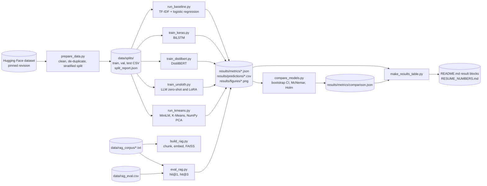
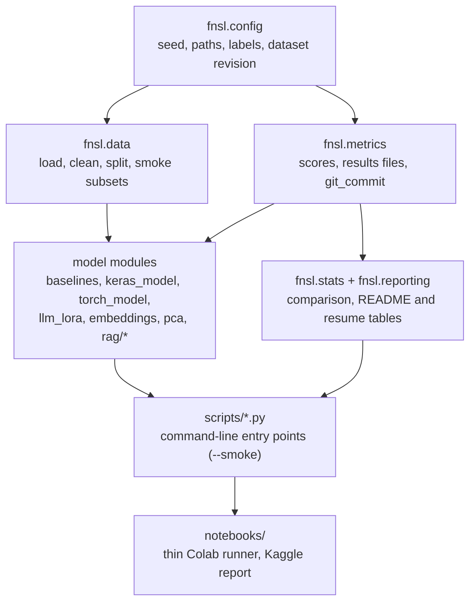

# Project guide: fin-news-sentiment-lab

**State of the project on 2026-11-14, code at commit `aaf142e`** (branch
`claude/project-skeleton-build-dj1aj6`). This guide explains what the project is, what is
finished, what is left for you, how the code is organised, which technologies were chosen
and why, and the machine-learning concepts and mathematics behind every part. The
mathematics is in four chapters under [`docs/math/`](math/) (section 8).

> **Numbers rule.** Every number quoted here as a *result* is copied from
> `results/metrics/*.json` or `data/splits/split_report.json`, and the file is named next
> to it. Every other number is a setting read from the code, a check you can rerun (named
> as such), or arithmetic shown in full. Models that have only had a `--smoke` run (Keras,
> DistilBERT, the LLM) have **no results yet**, and this guide does not pretend otherwise.

## Contents

1. [Overview](#1-overview)
2. [Status: what is done](#2-status-what-is-done)
3. [What you need to do](#3-what-you-need-to-do)
4. [Architecture](#4-architecture)
5. [Tech stack](#5-tech-stack)
6. [Decision gates](#6-decision-gates)
7. [Where each ML concept lives](#7-where-each-ml-concept-lives)
8. [The mathematics, part by part](#8-the-mathematics-part-by-part)
9. [Interview questions from the plan](#9-interview-questions-from-the-plan)
10. [Appendix: command reference](#10-appendix-command-reference)

---

## 1. Overview

**Task.** Classify short English financial news posts (headline-style tweets) as
**Bearish**, **Bullish** or **Neutral**.

**Research question.** Are bigger models (a BiLSTM, a fine-tuned transformer, a
LoRA-fine-tuned LLM) *significantly* better than a strong bag-of-words baseline? "Better"
is measured on one fixed test split, with confidence intervals and paired significance
tests rather than a single score.

**Side studies.**
- Unsupervised: do sentence embeddings cluster by sentiment? (K-Means from scikit-learn;
  PCA written from scratch with the NumPy SVD.)
- Retrieval: a LangChain RAG pipeline over ten public central-bank statements, evaluated
  with hit@k.

**Why it is built this way.** The project is portfolio evidence for a data-science
internship, so every claim must survive an interview:

| Principle | How the code enforces it |
|---|---|
| One fixed split, test set used once | `scripts/prepare_data.py` writes `data/splits/` once; `data.save_splits` refuses to overwrite; models are tuned on `val` only |
| Never invent numbers | README result blocks and `RESUME_NUMBERS.md` are generated from results files by `scripts/make_results_table.py` |
| Smoke runs are never results | `--smoke` writes only to `results/smoke/` and `checkpoints/smoke/` (gitignored); reporting ignores smoke files |
| Every result is traceable | each results JSON stores `git_commit` (with `-dirty` if `src/` or `scripts/` differ from it), `seed`, `params` and `timestamp` |
| Differences must be significant, not just larger | bootstrap 95% CIs, McNemar's test and Holm correction in `scripts/compare_models.py` |
| Code you can explain | explicit PyTorch loop (no `Trainer`), PCA from SVD by hand, small modules with comments |

**Deliverables** (from `PROJECT_PLAN.md`, section 1) and where they stand:

| Deliverable | State |
|---|---|
| GitHub repo with structure, tests and CI | Done: 236 tests (199 run in CI), CI green |
| Results table of 4 models with bootstrap CIs and McNemar tests | Machinery done; only the TF-IDF baseline has results so far |
| Hugging Face model card for the fine-tuned DistilBERT | Generator done (`scripts/push_to_hub.py`); needs the trained model |
| Public Kaggle notebook | `notebooks/kaggle_report.ipynb` done; not published yet |
| `reading_log.md` (3 papers), `DEBUG_LOG.md` (one bug per day) | Reading log is an empty template for your words; DEBUG_LOG has real bugs from the build, marked *(skeleton build)* |
| `RESUME_NUMBERS.md` generated from results | Generator done; currently marks every bullet "do not use yet" |

---

## 2. Status: what is done

### 2.1 By plan day

"Done when" is the plan's own gate for each day.

| Day | Topic | Code | Real run | Plan's "Done when" gate | State |
|---|---|---|---|---|---|
| 1 | Scaffold, data, fixed split | ✅ | ✅ | split files exist, tests pass, CI green | **Done** |
| 2 | TF-IDF + logistic regression | ✅ | ✅ | `tfidf_logreg.json` and predictions CSV exist | **Done** |
| 3 | K-Means + PCA via SVD | ✅ | ✅ | PCA test passes, cluster plot saved | **Done** |
| 4 | Keras BiLSTM | ✅ | smoke only | test predictions CSV for Keras exists | **You:** run on CPU |
| 5 | DistilBERT training script | ✅ | smoke only | smoke passes locally ✅; Colab run shows falling loss ❌ | **You:** Colab run |
| 6 | Evaluate DistilBERT, results table, reading log | ✅ table generator | — | table shows TF-IDF, Keras and DistilBERT | Needs Days 4–5 runs + FinBERT entry |
| 7 | McNemar + bootstrap comparison | ✅ | ✅ (one model only) | every pair listed with significance | Needs at least 2 models |
| 8 | Unsloth zero-shot | ✅ | never run (no GPU) | model loads, labels parse | **You:** Colab |
| 9 | LoRA fine-tune | ✅ | never run | adapter saved, loss falls | **You:** Colab |
| 10 | LoRA evaluation, full comparison | ✅ | never run | table and comparison cover 4 models | **You:** Colab, then compare |
| 11 | LangChain RAG pipeline | ✅ | ✅ index + demo answer | a sample question returns relevant chunks and an answer citing its source | Done (check it yourself) |
| 12 | RAG evaluation | ✅ | smoke only | hit@3 reported for two chunk sizes | **You:** write 20–30 questions |
| 13 | README, Kaggle notebook, reading log | ✅ README + notebook | — | notebook public, README renders | **You:** publish, write |
| 14 | Model card, CI, resume numbers | ✅ generators, CI green | — | CI green ✅, model card live ❌, `RESUME_NUMBERS.md` exists ✅ | After DistilBERT |

### 2.2 Every script

| Script | State | Notes |
|---|---|---|
| `scripts/prepare_data.py` | ran fully | wrote `data/splits/{train,val,test}.csv` + `split_report.json` |
| `scripts/run_baseline.py` | ran fully (+ smoke) | `results/metrics/tfidf_logreg.json`, predictions, confusion figure |
| `scripts/run_kmeans.py` | ran fully (+ smoke) | `results/metrics/kmeans.json`, `results/figures/kmeans_pca.png` |
| `scripts/compare_models.py` | ran fully (+ smoke) | `comparison.json`: CIs for `tfidf_logreg`; no pairs yet (one model) |
| `scripts/make_results_table.py` | ran fully | README blocks + `RESUME_NUMBERS.md` |
| `scripts/build_rag.py` | ran fully | FAISS index in `cache/rag_index/` + a demo answer; writes no metric |
| `scripts/train_keras.py` | smoke only | the full run is meant for a laptop CPU (Colab fallback cell in the notebook) |
| `scripts/train_distilbert.py` | smoke only | full run needs a GPU (Colab) |
| `scripts/train_unsloth.py` | smoke only, HF backend | smoke used SmolLM2-135M on CPU; the Unsloth path has never run |
| `scripts/eval_rag.py` | smoke only | real run needs at least 5 questions written by you |
| `scripts/push_to_hub.py` | dry run only | card in `results/model_card/` (gitignored); no model to push yet |
| `notebooks/colab_runner.ipynb` | not run | needs a Colab GPU; tests check its commands against each script's parser |
| `notebooks/kaggle_report.ipynb` | run by tests | executed against the committed results |

### 2.3 Real results so far

From `data/splits/split_report.json`:

- 11,931 raw rows → 11,775 after cleaning: 3 URL-only, 6 with conflicting labels and 147
  near-duplicates removed.
- Stratified split: train 8,241, val 1,767, test 1,767.

| Class | Rows (all) | Share |
|---|---|---|
| Bearish | 1,765 | 15.0% |
| Bullish | 2,380 | 20.2% |
| Neutral | 7,630 | 64.8% |

From `results/metrics/tfidf_logreg.json` (test split, n = 1,767) and
`results/metrics/comparison.json` (bootstrap, 2,000 resamples):

| Metric | Value |
|---|---|
| Macro-F1 | **0.739** (95% CI [0.715, 0.762]) |
| Accuracy | 0.804 (95% CI [0.786, 0.822]) |
| F1 Bearish / Bullish / Neutral | 0.633 / 0.708 / 0.876 |
| Chosen on validation | C = 3.0, `class_weight="balanced"` (val macro-F1 0.733) |
| Vocabulary (unigrams + bigrams, min_df 2) | 16,172 features |

Confusion matrix of the baseline on the test split (rows = true label, columns =
predicted label):

| | pred Bearish | pred Bullish | pred Neutral |
|---|---|---|---|
| **Bearish** | 177 | 21 | 67 |
| **Bullish** | 42 | 247 | 68 |
| **Neutral** | 75 | 73 | 997 |

From `results/metrics/kmeans.json` (MiniLM embeddings of the 8,241 train texts):

| k | Silhouette | ARI | NMI | Majority label of every cluster |
|---|---|---|---|---|
| 3 | 0.012 | 0.050 | 0.051 | Neutral |
| 5 | 0.011 | 0.043 | 0.054 | Neutral |

The first two principal components keep 3.8% and 2.8% of the embedding variance. The
honest reading: the clusters barely line up with sentiment (ARI close to 0, every cluster
mostly Neutral). An informal look suggests they follow topic instead; section [8.4.15](math/2_embeddings_pca_kmeans.md#8415-what-clustering-agreement-says-and-does-not-say-about-sentiment)
treats that as a hypothesis, not a result.

### 2.4 Quality state

- 236 tests (199 not marked `heavy`).
- `pytest -m "not heavy"` and `ruff check .` pass locally and in GitHub Actions
  (Python 3.11, light dependencies only).
- The 37 heavy tests (TensorFlow, PyTorch, LLM smoke, embeddings, notebook execution) pass
  locally at `aaf142e`.

---

## 3. What you need to do

In order. After every step that produces results, run the two refresh commands, check the
tests, and commit:

```bash
python scripts/compare_models.py
```

```bash
python scripts/make_results_table.py --update-readme --count-tests
```

1. **Put the code on `main` and make the repository public.** The remote has only this
   branch, and the Colab notebook clones `main` without a token, so the repository must be
   public. Create `main` from the branch, then set `main` as the default branch on GitHub:
   ```bash
   git push origin claude/project-skeleton-build-dj1aj6:main
   ```
   Until then, set `BRANCH = "claude/project-skeleton-build-dj1aj6"` in the notebook.
2. **Local setup** (once):
   ```bash
   python -m venv .venv && source .venv/bin/activate
   ```
   ```bash
   pip install -r requirements.txt && pip install -e . --no-deps
   ```
   For TensorFlow, PyTorch CPU and embeddings, also install the CPU torch wheel and
   `requirements-local.txt` (see README).
3. **Day 4, Keras (laptop CPU):**
   ```bash
   python scripts/train_keras.py
   ```
4. **Days 5–7, DistilBERT (Colab, T4 GPU).** In `notebooks/colab_runner.ipynb`, run the
   smoke cell, then the full run, and optionally seeds 43 and 44. Download `results.zip`,
   unzip it into the repo, refresh, and commit. Write the FinBERT entry in
   `reading_log.md` (Day 6).
5. **Days 8–10, LLM (Colab).** Run zero-shot, LoRA train and LoRA eval in **one** session
   (a new session has no `checkpoints/`). Optionally run zero-shot on the full test split
   (`--n-test 0`) so McNemar can pair it. Copy back, refresh, commit. Write the LoRA entry
   (Day 10). If the Unsloth install fails twice, follow the plan's fallback (section 6.1).
6. **Days 11–12, RAG.** Run `python scripts/build_rag.py --question "..."` once and read
   the answer. Write 20–30 questions in `data/rag_eval.csv` (format in section [8.8](math/4_llm_lora_rag.md#88-retrieval-augmented-generation-rag-and-hitk)), then
   run `python scripts/eval_rag.py`, refresh, and commit.
7. **Day 13.** Write the README *Findings* section (which model wins, whether the gap is
   significant, the cost of each extra point of macro-F1). Write the RAG paper entry.
   Publish `notebooks/kaggle_report.ipynb` on Kaggle. Review the *(skeleton build)*
   entries in `DEBUG_LOG.md` and add your own.
8. **Day 14.** In the notebook's zip cell, tick `INCLUDE_DISTILBERT_CHECKPOINT` when you
   train DistilBERT, so you have the weights locally. Then push the model card:
   ```bash
   python scripts/push_to_hub.py --push --repo-id <user>/<name> --checkpoint checkpoints/distilbert/best
   ```
   Confirm the licence, check CI is green, and fill the resume **only** from
   `RESUME_NUMBERS.md`.

### 3.1 Decisions to make before the real runs

All of these are optional: the current defaults work, and the chapters explain them. If you
change something, judge it on the validation split only, and give the run its own
`--run-name`. Every predictions file in `results/predictions/` enters the comparison, and
more pairs make the Holm correction stricter.

| Question | Default now | Why it matters | Read |
|---|---|---|---|
| Strip `t.co` links for DistilBERT (and TF-IDF), as the Keras model does? | links kept | one link costs about a dozen WordPiece pieces of DistilBERT's 64-token budget; changing TF-IDF means a new baseline run | [8.2](math/1_data_baseline_stats.md#82-tf-idf--logistic-regression-baseline), [8.6](math/3_keras_distilbert.md#86-distilbert-fine-tuning-with-an-explicit-pytorch-loop) |
| Use class weights in DistilBERT's loss, as Keras and the baseline do? | unweighted | minority classes drive macro-F1, and the models then differ in more than architecture; there is no flag yet, so this needs a small code change | [8.5](math/3_keras_distilbert.md#85-keras-bilstm-classifier), [8.6](math/3_keras_distilbert.md#86-distilbert-fine-tuning-with-an-explicit-pytorch-loop) |
| Train the Keras `[UNK]` vector with a smaller vocabulary cap? | `--max-tokens 20000`, more than the number of training words, so `[UNK]` never trains | unknown validation and test words all map to an untrained vector; the chapter suggests a variant run | [8.5](math/3_keras_distilbert.md#85-keras-bilstm-classifier) |
| Use one model-selection rule for both neural models? | Keras: class-weighted validation loss (early stopping); DistilBERT: validation macro-F1 per epoch | fine as it is, but be ready to explain the difference | [8.5](math/3_keras_distilbert.md#85-keras-bilstm-classifier), [8.6](math/3_keras_distilbert.md#86-distilbert-fine-tuning-with-an-explicit-pytorch-loop) |
| Run zero-shot on the whole test split? | 50 rows | McNemar needs identical test ids, so the 50-row run is left out of the pairs; `--n-test 0` includes it | [8.3](math/1_data_baseline_stats.md#83-statistical-comparison-bootstrap-mcnemar-holm-seed-variation), [8.7](math/4_llm_lora_rag.md#87-small-llm-zero-shot-prompting-and-lora-fine-tuning-unsloth) |
| Which variant runs to keep? | none exist | each extra predictions file is paired with every other one; seed reruns are summarised instead of paired | [8.3](math/1_data_baseline_stats.md#83-statistical-comparison-bootstrap-mcnemar-holm-seed-variation) |
| Rebuild the RAG demo index with the winning chunk size? | `build_rag.py` uses 500; the evaluation compares 300 and 800 | the demo then uses the setting you report | [8.8](math/4_llm_lora_rag.md#88-retrieval-augmented-generation-rag-and-hitk) |

### 3.2 What to check on your first GPU run

Nothing below could be checked here, because there is no GPU in this environment.

- The notebook's install step prints the versions; they must fall inside the ranges in
  `requirements-gpu.txt`, and `import unsloth` must work.
- DistilBERT: the training loss falls from epoch to epoch, and no loss is NaN. The CUDA
  path (float16 autocast with gradient scaling) has never run.
- LoRA: `val_loss_end` is below `val_loss_start` in `results/metrics/llm_lora_train.json`,
  and `params.train_backend` in `llm_lora.json` is `unsloth`.
- Zero-shot and LoRA evaluation: `n_unparseable` is small. If not, read
  `most_common_outputs` and `unparseable_examples` in the metrics JSON.
- Unsloth behaviour that comes from documentation or code comments rather than a run here
  (input truncation, the compute dtype on a T4) is listed in chapter 4 ([8.7.5](math/4_llm_lora_rag.md#875-4-bit-quantisation-nf4-bitsandbytes-and-the-qlora-idea), [8.7.10](math/4_llm_lora_rag.md#8710-unsloth-input-truncation-and-inference_max_seq_length)).

---

## 4. Architecture

### 4.1 Data and results flow



Training scripts never talk to each other. They meet only through files: the split CSVs
going in, and the results files coming out. That is what makes it safe to train some
models on a laptop and others on Colab.

### 4.2 Code layers



- `src/fnsl/` holds reusable logic.
- `scripts/` are the entry points: argument parsing, the training run, and writing
  results.
- Notebooks only call scripts. No logic lives only in a notebook.

### 4.3 Repository layout

```
fin-news-sentiment-lab/
├── PROJECT_PLAN.md, CLAUDE.md     the 14-day plan and the working rules
├── README.md                      public summary; result blocks are generated
├── RESUME_NUMBERS.md              generated: the only allowed source of resume numbers
├── DEBUG_LOG.md, reading_log.md   one real bug per day; paper summaries in your words
├── docs/PROJECT_GUIDE.md          this guide
├── docs/math/                     the mathematics, four chapters (section 8)
├── requirements*.txt              three install tiers (section 5)
├── pyproject.toml, pytest.ini     package "fnsl", ruff rules, the `heavy` test marker
├── .github/workflows/ci.yml       ruff + pytest -m "not heavy" on every push
├── data/
│   ├── splits/                    fixed train/val/test CSVs + split_report.json (read-only)
│   ├── rag_corpus/                10 central-bank statements + SOURCES.md (licences)
│   └── rag_eval.csv               your retrieval questions (3 EXAMPLE rows so far)
├── src/fnsl/
│   ├── config.py                  seed 42, paths, label map, dataset name + revision
│   ├── data.py                    load, clean, de-duplicate, split, smoke subsets
│   ├── metrics.py                 macro-F1, results JSON/CSV/figure, git_commit stamp
│   ├── tracking.py                MLflow wrapper (SQLite in mlruns/, optional)
│   ├── baselines.py               TF-IDF + logistic regression, validation grid
│   ├── embeddings.py              MiniLM sentence embeddings with a disk cache
│   ├── pca.py                     PCA from NumPy SVD
│   ├── keras_model.py             TextVectorization + BiLSTM
│   ├── torch_model.py             DistilBERT data loading + explicit training loop
│   ├── llm_lora.py                prompts, label parser, model loading, LoRA, generation
│   ├── stats.py                   bootstrap CIs, McNemar, paired bootstrap, Holm
│   ├── reporting.py               README sections and RESUME_NUMBERS.md text
│   └── rag/                       ingest (load + chunk), retriever (FAISS), evaluate (hit@k)
├── scripts/                       prepare_data, run_baseline, run_kmeans, train_keras,
│                                  train_distilbert, train_unsloth, compare_models,
│                                  make_results_table, build_rag, eval_rag, push_to_hub
├── notebooks/                     colab_runner.ipynb (GPU runs), kaggle_report.ipynb
├── results/                       metrics/*.json, predictions/*.csv, figures/*.png
└── tests/                         one test file per module; `heavy` = needs big libraries
```

Gitignored, created when you run things:

- `data/raw/`: dataset download cache.
- `cache/`: embeddings and the RAG index.
- `checkpoints/`: model weights.
- `mlruns/`: MLflow runs.
- `results/smoke/`: smoke outputs.
- `results/model_card/`: the generated model card.

### 4.4 File contracts

Scripts agree only on file formats, so these are the project's interfaces.

| File | Written by | Content |
|---|---|---|
| `data/splits/{train,val,test}.csv` | `prepare_data.py` | columns `id,text,label` (label 0 = Bearish, 1 = Bullish, 2 = Neutral); ids are unique across splits |
| `data/splits/split_report.json` | `prepare_data.py` | `dataset, revision, license, seed, fractions, cleaning, sizes, class_balance, labels` |
| `results/predictions/<model>.csv` | every classifier | columns `id,text,label,pred`; `pred = -1` means an LLM answer that matched no label (counted wrong) |
| `results/metrics/<model>.json` | every classifier via `metrics.save_results` | required: `model, dataset, n_test, macro_f1, accuracy, per_class_f1, seed, train_time_s, params, git_commit, timestamp`; also `smoke, confusion_matrix, n_unparseable` and model-specific extras |
| `results/metrics/comparison.json` | `compare_models.py` | per-model CIs (`models`), McNemar + paired-bootstrap `pairs` with Holm p-values, `skipped_pairs`, `skipped_models`, `seed_runs` |
| `results/metrics/kmeans.json` | `run_kmeans.py` | per k: `silhouette, ari, nmi, contingency, cluster_majority_label, cluster_purity, overall_purity`; PCA variance ratios |
| `results/metrics/rag_eval.json` | `eval_rag.py` (real run) | per chunk size: `n_chunks, hit@1, hit@3`; `best_chunk_size, n_questions, embedding_model` |
| `results/metrics/llm_lora_train.json` | `train_unsloth.py --mode train` | LoRA settings, trainable parameters, train/val loss curves; no test scores |
| `checkpoints/<run>/best/training_info.json` | `train_distilbert.py` | hyperparameters, seed, best epoch, training commit; lets `--eval-only` and `push_to_hub.py` check the weights |

Each mathematics chapter ends with the exact fields of the files its part reads and writes.

### 4.5 Run modes and where things run

| | Real run | Smoke run (`--smoke`) |
|---|---|---|
| Data | full splits | deterministic, label-balanced subsets: 200 train / 64 val / 64 test (`config.SMOKE_SIZES`); K-Means uses 300 train texts |
| Epochs / steps | script defaults | 1 epoch or a few steps; tiny model for the LLM (SmolLM2-135M) |
| Outputs | `results/`, `checkpoints/` | `results/smoke/`, `checkpoints/smoke/` (gitignored) |
| MLflow | on (unless `--no-mlflow`) | off |
| Purpose | results you may report | proves the code runs end to end; never reported |

The smoke subsets use the same ids in every script. This means smoke predictions of
different models can be paired, which tests the comparison code too.

| Where | What runs there |
|---|---|
| Laptop CPU | data, split, TF-IDF, K-Means, PCA, Keras (full run fits a CPU), statistics, tables, RAG, all smoke runs, tests |
| Colab / Kaggle GPU (T4) | DistilBERT full fine-tune, Unsloth zero-shot / LoRA / evaluation |
| GitHub Actions | `ruff check .` and `pytest -m "not heavy"` on Python 3.11 with `requirements.txt` only |

### 4.6 Reproducibility and provenance

- **Seeds.** `config.set_seed(42)` seeds Python, NumPy and (if already imported)
  PyTorch / TensorFlow. Scripts take `--seed`.
- **Data version.** The Hub dataset is pinned to a revision in `config.py`. The raw
  download is cached in `data/raw/`.
- **Fixed split.** Created once. `data.save_splits` raises instead of overwriting, and
  `data.load_split` checks columns and labels on every read.
- **Commit stamp.** `metrics.git_commit()` stores the short commit hash in every results
  file. It adds `-dirty` if anything under `src/` or `scripts/` is modified *or new and
  uncommitted*, so a result can always be traced to the code that produced it. Commit
  your code first, then run.
- **MLflow** logs parameters, metrics and figures to a local SQLite database in `mlruns/`
  (not committed). It is optional; results files are the source of truth.
- **Caches.** Embeddings are cached under a hash of model name + options + texts, and
  re-running reproduces identical vectors. The RAG index is cached in `cache/rag_index/`.
- **Limits.** GPU training is not bit-for-bit reproducible (cuDNN / cuBLAS). The
  embedding model is not pinned to a Hub revision.

### 4.7 Tests and CI

- `pytest.ini` defines the `heavy` marker for tests that need TensorFlow, PyTorch,
  transformers or model downloads.
- CI runs only `pytest -m "not heavy"`, so it needs `requirements.txt` alone.
- There is one test file per module. Typical checks:
  - the split adds up and has no overlap (ids, texts or near-duplicate keys);
  - the metrics schema;
  - PCA against scikit-learn up to sign;
  - bootstrap CI contains the point estimate; McNemar gives p = 1 for identical
    predictions;
  - the LLM label parser;
  - RAG chunking and hit@k on a fixture corpus;
  - smoke runs never write real results;
  - notebooks have no outputs, secrets or local paths.
- Counts: 236 tests collected, 199 not heavy.

---

## 5. Tech stack

Versions are the ones installed in the local environment on 2026-11-14. The ranges are the
pins in the requirements files.

| Area | Library (installed) | Pinned range | Used for | Why this choice |
|---|---|---|---|---|
| Language | Python 3.13 (CI: 3.11) | `>=3.11` | everything | modern typing; 3.11 keeps CI close to Colab |
| Data | pandas 3.1.1, NumPy 2.5.4 | pandas `>=2.2,<4`, numpy `>=1.26,<3` | tables, arrays | standard; pandas 3 needs `keep_default_na=False` so a tweet "NA" stays text |
| Dataset access | datasets 4.8.5 | `>=4.7,<5` | Hub download | official loader; `<5` matches Unsloth's limits |
| Classical ML | scikit-learn 1.9.1 | `>=1.5,<2` | TF-IDF, logistic regression, K-Means, metrics | simple, fast, explainable baseline |
| Statistics | statsmodels 0.15.0, SciPy | `>=0.14` | McNemar's test | tested implementation (with one edge case patched, section [8.3](math/1_data_baseline_stats.md#83-statistical-comparison-bootstrap-mcnemar-holm-seed-variation)) |
| Plots | matplotlib 3.11.2 | `>=3.8` | confusion matrices, PCA plot | standard |
| Tracking | MLflow 3.18.0 | `>=3.0,<4` | run logging | owner already knows it; SQLite backend because MLflow 3 puts the `./mlruns` file store in maintenance mode |
| Embeddings | sentence-transformers 6.3.0 | `>=5.0,<7` | MiniLM sentence vectors | small (384-d), fast on CPU |
| Keras | TensorFlow 2.21.0, Keras 3.15.1 | `tensorflow>=2.18,<3` | BiLSTM | required by the job post; preinstalled on Colab |
| PyTorch | torch 2.14.1 (CPU build locally) | `>=2.4,<2.15` | DistilBERT loop | required by the job post; explicit loop is explainable |
| Transformers | transformers 5.17.0 | `>=5.2,<=5.17.0` | DistilBERT, tokenizers, LLM loading | the upper pin is Unsloth's limit, so locally tested code matches Colab |
| LLM fine-tuning | Unsloth (GPU only, not installed locally) | `>=2026.11` | 4-bit loading, fast LoRA | required by the job post; fits a 1.5B model on a free T4 |
| LoRA / SFT | peft 0.21.3, trl 1.15.0, accelerate 1.15.0, bitsandbytes (GPU) | `peft>=0.18`, `trl>=1.0,<=1.15.0` | adapters, supervised fine-tuning | what Unsloth builds on; `trl` pinned to Unsloth's limit |
| RAG | langchain-core 1.8.0, langchain-community 0.4.2, langchain-text-splitters 1.1.3, langchain-huggingface 1.2.3 | `<2` / `<0.5` | splitter, embeddings wrapper, FAISS store, LCEL chain | required by the job post |
| Vector search | faiss-cpu 1.16.0 | `>=1.8` | exact nearest-neighbour search | in-process, no server, exact search is fine for ~100 chunks |
| Hub publishing | huggingface_hub 1.33.0 | `>=1.0` | model card push | official client |
| Quality | pytest 9.2.0, ruff 0.17.5, nbformat / nbclient / ipykernel | `pytest>=8`, `ruff>=0.6` | tests, lint + format, notebook checks | fast; notebooks are linted too |
| CI | GitHub Actions (ubuntu-latest, Python 3.11) | — | lint + fast tests on every push | free, already known |

**Models and data used.**

| Name | Licence | Role |
|---|---|---|
| `zeroshot/twitter-financial-news-sentiment` (revision `ccbe24de…`) | MIT | the dataset |
| `atrost/financial_phrasebank` (pinned) | CC BY-NC-SA 3.0 | fallback dataset, not used |
| `sentence-transformers/all-MiniLM-L6-v2` | Apache-2.0 | sentence embeddings (K-Means, RAG) |
| `distilbert/distilbert-base-uncased` | Apache-2.0 | transformer to fine-tune |
| `unsloth/Qwen2.5-1.5B-Instruct-unsloth-bnb-4bit` | Apache-2.0 | default LLM (4-bit) |
| `HuggingFaceTB/SmolLM2-135M-Instruct` | Apache-2.0 | tiny LLM for CPU smoke runs |
| `Qwen/Qwen2.5-0.5B-Instruct` | Apache-2.0 | optional local RAG answer generator |

**Three install tiers.** These keep CI fast and avoid multi-GB installs where they are not
needed.

| File | Adds | For |
|---|---|---|
| `requirements.txt` | light libraries only (no torch / TensorFlow) | CI, data, baseline, statistics, tables |
| `requirements-local.txt` | CPU torch, transformers, TensorFlow, sentence-transformers, LangChain HF | laptop: embeddings, RAG, smoke runs, heavy tests |
| `requirements-gpu.txt` | Unsloth, peft, trl, bitsandbytes | Colab / Kaggle GPU |

---

## 6. Decision gates

A *gate* is a check that must pass before moving on, or that stops a wrong number from
reaching the README or the resume.

### 6.1 Gates from the plan

| Gate | Rule | Status |
|---|---|---|
| "Done when" per day | each day has a concrete finish condition (table in section 2.1) | Days 1–3 and 11 met |
| Test set | used only for final evaluation, never for tuning | enforced: tuning grids use `val` only; each test split is scored once per run |
| Fixed split | read-only after Day 1 | enforced by `data.save_splits` |
| Resume numbers | only from `RESUME_NUMBERS.md` | generated; currently "do not use" for every bullet |
| Skills line | PyTorch, TensorFlow/Keras after Days 4–6; Hugging Face after Days 5–6; Unsloth after Day 10; LangChain after Day 12; "Hypothesis testing" after Day 7 | implemented as file checks in `reporting.py` (section 6.2); Unsloth also needs `params.train_backend = unsloth` in `llm_lora.json`; today only scikit-learn is YES |

**Fallbacks** (plan section 10). These are decisions you make when a gate fails:

| If… | Then… |
|---|---|
| Local TensorFlow install fails | run `train_keras.py` in Colab (the notebook has a cell); log it in DEBUG_LOG |
| Colab disconnects | every run saves checkpoints and predictions; keep runs under 30 min; rerun evaluation with `--eval-only` (DistilBERT) |
| Unsloth install or model load fails twice | stop at Day 8, skip Days 9–10, do **not** claim Unsloth; use the time for a second DistilBERT seed (Day 7) |
| Dataset fails to load | `python scripts/prepare_data.py --source fallback` (the parquet mirror); note it in the README |
| Time runs short | minimum path: Days 1–7, 13, 14 |
| Test set gives wide CIs | report them; never tune on the test set |

### 6.2 Gates enforced in the code

Grouped by part of the project. Project-wide gates (the split, results files, provenance, reporting) are under the first group.

#### Data, the baseline and the statistics (Days 1, 2, 7) — [chapter](math/1_data_baseline_stats.md)

| Gate | What it prevents | Where |
|---|---|---|
| save_splits refuses to overwrite existing split files unless overwrite=True (--overwrite) | Accidental re-splitting after Day 1, which would invalidate every result | src/fnsl/data.py → save_splits; scripts/prepare_data.py |
| load_split checks columns == id,text,label and labels within {0,1,2}; raises FileNotFoundError naming prepare_data.py if a split is missing | Malformed, hand-edited or missing split files being used silently | src/fnsl/data.py → load_split |
| make_splits requires split fractions summing to 1 (within 1e-9) | Inconsistent split sizes | src/fnsl/data.py → make_splits |
| clean drops URL-only rows, whole conflicting-label groups and later near-duplicate copies | Train/test leakage of the same headline (exact-key copies); unknowable labels | src/fnsl/data.py → clean, dedup_key |
| test_no_overlap_between_splits (ids, exact texts, dedup keys) and test_splits_are_stratified | Leakage between splits and unstratified splits going unnoticed | tests/test_data.py |
| Tuning scores on val only; the test split is predicted once per run after refitting | Tuning on the test set (selection bias) | src/fnsl/baselines.py → tune_on_val; scripts/run_baseline.py → main |
| Smoke runs write to results/smoke/ (output_dirs(smoke=True)) | Smoke outputs overwriting or posing as real results | src/fnsl/config.py → output_dirs; src/fnsl/metrics.py → save_results |
| save_results raises if the number of predictions differs from the number of test rows | Predictions not lined up with test rows | src/fnsl/metrics.py → save_results |
| git_commit appends '-dirty' when src/ or scripts/ have modified or untracked files | Results from uncommitted code carrying a clean commit stamp (flags them) | src/fnsl/metrics.py → git_commit |
| resolve_paths treats --smoke or a predictions dir inside results/smoke/ as a smoke run | Smoke predictions writing the real results/metrics/comparison.json | scripts/compare_models.py → resolve_paths |
| load_all_predictions validates columns, non-empty file, unique ids, label in {0,1,2}, pred in {0,1,2,-1}; failures go to skipped_models with a reason | Broken prediction files crashing the comparison or being silently dropped/truncated | scripts/compare_models.py → load_all_predictions; src/fnsl/metrics.py → load_predictions |
| compare_models exits with a message, writing nothing, when no usable predictions CSV exists or --models names a missing file | An empty or partial comparison.json being written as if complete | scripts/compare_models.py → main, load_all_predictions |
| align_pair requires identical test id sets and agreeing labels; otherwise skipped_pairs with a reason | Pairing models scored on different rows (e.g. a 50-row zero-shot run) or inconsistent files | scripts/compare_models.py → align_pair |
| find_seed_reruns counts a <model>_seed<N> file as a rerun only if it aligns with the kept run | A mismatched rerun hiding inside the seed summary instead of being reported | scripts/compare_models.py → find_seed_reruns |
| mcnemar_test returns p = 1 when b == c | Evenly split models getting p < 1 from the corrected chi-square, and identical predictions getting p = 0 when exact=False (statsmodels edge case) | src/fnsl/stats.py → mcnemar_test |
| Input checks: 1-D equal-length non-empty arrays, n_resamples >= 1, 0 < alpha < 1, p-values flat, in [0,1] and not NaN | Silent garbage statistics from bad inputs | src/fnsl/stats.py → _as_int_arrays, _check_bootstrap_args, holm_adjust |
| significant_holm = Holm-adjusted McNemar p < alpha is the verdict shown in README/RESUME | False 'significant' claims from testing many pairs | scripts/compare_models.py → build_comparison; src/fnsl/reporting.py → comparison_section, _significance |
| load_result ignores JSONs with smoke=true; smoke per-model records are filtered and listed as ignored | Smoke numbers appearing in README or RESUME_NUMBERS.md | scripts/make_results_table.py → load_result, main |
| is_model_metrics requires all 11 REQUIRED_METRIC_KEYS | comparison.json, kmeans.json or rag_eval.json being treated as model rows | src/fnsl/metrics.py → is_model_metrics, load_metrics |
| consistent_ci (same n, macro-F1 within 1e-9) and split_pairs (both models current and with a real metrics JSON) | Stale CIs or pair results shown after a model was retrained | src/fnsl/reporting.py → consistent_ci, split_pairs, stale_pairs_note |
| comparable_note / _macro_f1_line for models whose n_test differs from the full test split | Subset scores being compared or put on the resume (flags 'not comparable', RESUME WARNING) | src/fnsl/reporting.py → comparable_note, _macro_f1_line |
| Expected models without a metrics JSON show 'not run yet' plus the command (tests assert no digits) | Any number appearing for a model that was never run | src/fnsl/reporting.py → results_section; tests/test_results_table.py |
| _bullet_1 requires >= 4 distinct models (seed reruns merged) in current pairs | Writing 'compared four models' prematurely | src/fnsl/reporting.py → _bullet_1 |
| _skills marks a skill YES only if a real results file backs it (hypothesis testing needs a current pair; Unsloth needs `params.train_backend = unsloth`) | Claiming PyTorch, Hugging Face, Keras, Unsloth, LangChain or hypothesis testing on the resume too early | src/fnsl/reporting.py → _skills |
| replace_section requires each BEGIN/END marker exactly once and in order; update_readme writes only if all sections succeed | Half-written README and edits to hand-written text outside the markers | src/fnsl/reporting.py → replace_section; scripts/make_results_table.py → update_readme |
| count_tests returns an error message instead of a number if pytest collection fails | Reporting a wrong test count | scripts/make_results_table.py → count_tests |
| seed_runs_note shows mean ± std only while every run matches its metrics JSON | Stale seed-variation numbers after a rerun was retrained | src/fnsl/reporting.py → seed_runs_note |
| mlflow_run falls back to a no-op on import/setup failure, for --smoke and --no-mlflow | Tracking problems breaking a training run; smoke runs polluting the MLflow store | src/fnsl/tracking.py → mlflow_run; scripts/run_baseline.py → main |

#### Embeddings, PCA and K-Means (Day 3) — [chapter](math/2_embeddings_pca_kmeans.md)

| Gate | What it prevents | Where |
|---|---|---|
| argparse choices for --split are train/val only | Clustering (and so looking at) the test split, which is reserved for final evaluation | scripts/run_kmeans.py -> parse_args; tests/test_kmeans.py -> test_parse_args_rejects_bad_k_and_the_test_split |
| parse_args rejects any k < 2 or k > 8 (len(CLUSTER_COLORS)), then sorts and de-duplicates --ks | Meaningless or unplottable cluster counts | scripts/run_kmeans.py -> parse_args; tests/test_kmeans.py -> test_parse_args_rejects_bad_k_and_the_test_split |
| kmeans.json lacks 6 of the 11 REQUIRED_METRIC_KEYS (including macro_f1), so metrics.is_model_metrics returns False | The clustering record becoming a model row in the README results table or in RESUME_NUMBERS.md (both built from metrics.load_metrics). It cannot enter McNemar pairs anyway: compare_models.py pairs predictions CSVs and run_kmeans.py writes none | src/fnsl/metrics.py -> REQUIRED_METRIC_KEYS, is_model_metrics, load_metrics; asserted in tests/test_kmeans.py -> test_main_smoke_writes_kmeans_json_and_figure |
| Cache hit accepted only if the file's row count equals the number of texts (otherwise re-embed and overwrite) | Serving a cache file that does not match the input length | src/fnsl/embeddings.py -> embed_texts |
| Atomic cache write via per-process temp file + Path.replace | Half-written or clobbered cache files when runs are interrupted or concurrent | src/fnsl/embeddings.py -> embed_texts (DEBUG_LOG.md Day 3) |
| embed_texts raises ValueError on empty input | Silent empty embedding arrays | src/fnsl/embeddings.py -> embed_texts; tests/test_embeddings.py -> test_empty_input_raises |
| PCA input validation: 2-D input only; n_components >= 1 (constructor) and <= min(n, d); n >= 2; non-zero total variance; feature/column-count checks in transform and inverse_transform; RuntimeError if not fitted | Meaningless PCA fits and silent shape mismatches | src/fnsl/pca.py -> _as_2d_float, PCA.__init__, PCA.fit, PCA.transform, PCA.inverse_transform, PCA._check_fitted; tests/test_pca.py -> test_invalid_use_raises |
| PCA tested against sklearn (svd_solver='full') with sign alignment and tight tolerances | A wrong PCA (e.g. missing centring or a wrong variance denominator) passing CI | tests/test_pca.py -> _assert_matches_sklearn, _sign_alignment |
| Sign-rule tests: each component's largest-magnitude entry must be positive; flip_signs checked on a hand-made matrix | A change to the sign convention (mirrored plots) going unnoticed, which the sign-aligned sklearn comparison alone would not catch | tests/test_pca.py -> test_components_are_orthonormal_and_signs_are_fixed, test_flip_signs_makes_largest_entry_positive |
| Smoke test asserts normalize=True (and the batch size and model name) reach embed_texts | A silent change that would break the cosine interpretation of the Euclidean silhouette | tests/test_kmeans.py -> test_main_smoke_writes_kmeans_json_and_figure |
| tmp_results fixture redirects every results folder to a temp dir | Tests overwriting committed results/ | tests/conftest.py -> tmp_results |

#### Keras BiLSTM and DistilBERT (Days 4-6) — [chapter](math/3_keras_distilbert.md)

| Gate | What it prevents | Where |
|---|---|---|
| Import-time check that the Keras backend is TensorFlow | Running the string-input model (TextVectorization inside the model) on a JAX or PyTorch Keras backend | src/fnsl/keras_model.py (module top) |
| Vocabulary adapted on train texts only | Leakage of validation/test words into the model | src/fnsl/keras_model.py -> build_text_vectorizer; tests test_vectorizer_is_adapted_on_train_texts_only, test_train_keras_smoke_writes_schema |
| EMPTY_TEXT placeholder for texts with no words left | Fully masked rows, which the GPU cuDNN LSTM path asserts against | src/fnsl/keras_model.py -> standardize_text |
| balanced_class_weights raises ValueError if a class has no examples | Division by zero or a silently missing class | src/fnsl/keras_model.py -> balanced_class_weights |
| Train-based class weights also applied to the validation loss | Early stopping watching a different objective than the one trained | scripts/train_keras.py -> main |
| EarlyStopping with restore_best_weights=True | Saving and evaluating overfitted last-epoch weights | scripts/train_keras.py -> main; test_train_keras_keeps_the_best_val_epoch |
| --epochs must be at least 1 | Runs with no epoch to select or reload | scripts/train_keras.py -> parse_args; scripts/train_distilbert.py -> parse_args |
| Truncation counted, printed and recorded (Keras: texts longer than seq_len words; DistilBERT: longer than max_length tokens) | Silent truncation of long texts | src/fnsl/keras_model.py -> token_lengths; src/fnsl/torch_model.py -> count_truncated; params.train_texts_truncated |
| Smoke outputs isolated: results/smoke/, checkpoints/smoke/, MLflow off, '[SMOKE: not a result]' | Smoke numbers becoming results or overwriting real files | src/fnsl/config.py -> output_dirs; scripts/train_keras.py -> main, checkpoint_path; scripts/train_distilbert.py -> train, default_output_dir |
| Test split predicted exactly once, after validation-based selection | Tuning or model selection on the test set | scripts/train_keras.py -> main; scripts/train_distilbert.py -> train, evaluate_on_test |
| Evaluation loaders built with shuffle=False (val each epoch, test in evaluate_on_test) | Predictions written next to the wrong test ids (save_results checks only the number of predictions, not their order) | scripts/train_distilbert.py -> train, evaluate_on_test; src/fnsl/torch_model.py -> make_loader |
| TextDataset checks that encodings and labels have the same length | Misaligned inputs and labels | src/fnsl/torch_model.py -> TextDataset |
| load_model forces dtype=torch.float32 | float16 master weights that GradScaler cannot unscale | src/fnsl/torch_model.py -> load_model |
| Gradient clipping to global norm 1.0, after unscale_ on GPU | Exploding updates from one odd batch; clipping against scaled gradients | src/fnsl/torch_model.py -> train_one_epoch |
| GradScaler skips optimizer steps whose gradients contain inf/NaN | Corrupted weight updates from float16 overflow | src/fnsl/torch_model.py -> train_one_epoch |
| Best epoch saved only on strictly higher val macro-F1; best checkpoint reloaded from disk for test | Reporting last-epoch weights instead of the selected ones | scripts/train_distilbert.py -> train, evaluate_on_test; test_train_script_reloads_the_best_validation_epoch_not_the_last |
| Stale best/training_info.json deleted before training starts | An older run's metadata describing new weights after an interruption | scripts/train_distilbert.py -> train; test_interrupted_run_cannot_reuse_an_older_training_info |
| --eval-only requires --checkpoint and a training_info.json in it | Evaluating weights of unknown origin or writing wrong hyperparameters into metrics | scripts/train_distilbert.py -> parse_args, eval_only |
| --eval-only inherits the smoke flag from the checkpoint | A smoke checkpoint writing real results | scripts/train_distilbert.py -> eval_only |
| git_commit stamped '-dirty' for uncommitted or untracked src/scripts changes; train_git_commit kept separately | Results from uncommitted code passing as clean; losing which code trained the weights | src/fnsl/metrics.py -> git_commit; scripts/train_distilbert.py -> evaluate_on_test |
| Model card: missing input shown as 'Not available yet'; smoke distilbert.json ignored | Invented or smoke numbers in the published card | scripts/push_to_hub.py -> render_card, main |
| comparison_problem: missing, unexpected layout, smoke, no distilbert.json, no distilbert entry, or macro-F1 mismatch > 1e-9 | Showing a stale or half-read comparison in the card | scripts/push_to_hub.py -> comparison_problem |
| --push refusals: needs --repo-id USER/NAME, a real distilbert.json, a checkpoint with config.json and training_info.json whose params and seed match, and a Hugging Face token | Publishing unevaluated weights or weights from a different run | scripts/push_to_hub.py -> parse_args, main, checkpoint_problem, push_to_hub |
| Test: every 4-decimal number in a rendered card must come (up to sign) from an input file | Numbers in the card that no script produced | tests/test_model_card.py -> test_card_numbers_come_only_from_the_input_files |

#### Small LLM with LoRA, and RAG (Days 8-12) — [chapter](math/4_llm_lora_rag.md)

| Gate | What it prevents | Where |
|---|---|---|
| Unsloth import check: SystemExit with instructions when Unsloth cannot be imported | Running the default Unsloth backend where Unsloth is not installed; the message points to the Colab notebook, --smoke or --backend hf | scripts/train_unsloth.py → main |
| CUDA_VISIBLE_DEVICES defaults to 0 (setdefault: an existing value is kept) | TRL's ValueError when several GPUs are visible to one process (Kaggle GPU T4 x2) | scripts/train_unsloth.py → main |
| Missing adapter_config.json or train_info.json raises FileNotFoundError | Evaluating before an adapter has been trained | src/fnsl/llm_lora.py → read_adapter_info |
| PROMPT_VERSION mismatch raises ValueError | Evaluating an adapter with a prompt different from the one it was trained on | src/fnsl/llm_lora.py → read_adapter_info |
| Base model taken from adapter_config.json (message printed if --model-name differs) | Attaching an adapter to the wrong base model | scripts/train_unsloth.py → run_eval |
| Prompt length + max_new_tokens above model.max_seq_length raises ValueError (only when the model has that attribute, i.e. Unsloth) | Unsloth silently cutting the end of left-padded test prompts | src/fnsl/llm_lora.py → generate_labels |
| inference_max_seq_length = max(512, --max-seq-length) for zero-shot and eval loads | Reusing the short training limit (128) at inference | scripts/train_unsloth.py → resolve_settings, run_zero_shot, run_eval |
| count_too_long warning and n_train_too_long in the training log (flag, does not block; training rows only) | Unnoticed training rows whose answer would be cut by max_length truncation. Validation rows are not checked, and TRL silently drops a validation row whose answer was cut off | src/fnsl/llm_lora.py → count_too_long; scripts/train_unsloth.py → run_train |
| Ambiguous or label-free answers become UNPARSEABLE (-1) and count as wrong | Guessing a label from 'bullish or bearish' or from text that names no label | src/fnsl/llm_lora.py → parse_label |
| Training log has record_type training_log and no macro_f1 | llm_lora_train.json being loaded as a test result by load_metrics or shown in the results table | scripts/train_unsloth.py → make_train_record; src/fnsl/metrics.py → is_model_metrics, load_metrics |
| --smoke writes only to results/smoke/ and checkpoints/smoke/, with MLflow and 4-bit off | Smoke numbers overwriting or being mistaken for real results | scripts/train_unsloth.py → resolve_settings, run_zero_shot, run_train, run_eval; src/fnsl/config.py → output_dirs |
| 4-bit requested without CUDA: load_model prints a message and loads float32 | A bitsandbytes crash on CPU for 16-bit checkpoints such as the smoke model. It cannot help the default checkpoint, which is stored in 4 bits: loading it without bitsandbytes raises ImportError | src/fnsl/llm_lora.py → load_model |
| Pairs compared only on identical test ids and labels; 'not comparable' note and resume WARNING for partial test sets | McNemar between the 50-row zero-shot run and full-test models; ranking or quoting it as comparable | scripts/compare_models.py → align_pair; src/fnsl/reporting.py → comparable_note, _macro_f1_line |
| CPU test that importing the LLM code loads no heavy library | CI (no torch) failing to import fnsl.llm_lora or scripts/train_unsloth.py | tests/test_llm_parser.py → test_importing_the_llm_code_does_not_import_heavy_libraries |
| No .txt files raises FileNotFoundError; empty files are skipped | Building an index from nothing or from empty documents | src/fnsl/rag/ingest.py → load_corpus |
| chunk_overlap larger than chunk_size raises ValueError | An impossible splitter configuration | LangChain TextSplitter, called from src/fnsl/rag/ingest.py → chunk_documents |
| No chunks raises ValueError | An empty FAISS index | src/fnsl/rag/ingest.py → build_index |
| Missing index.faiss raises FileNotFoundError naming build_rag.py | Loading an index that was never built | src/fnsl/rag/ingest.py → load_index |
| allow_dangerous_deserialization=True only for the project's own cache files (documented risk) | Flags the pickle risk: never load an index.pkl from elsewhere | src/fnsl/rag/ingest.py → load_index |
| --k below 1 is an argparse error | Meaningless top-0 retrieval | scripts/build_rag.py → parse_args; scripts/eval_rag.py → parse_args |
| A real run with --embedding-model hashing exits | A stand-in embedding producing results/metrics/rag_eval.json | scripts/eval_rag.py → main |
| CSV header must be exactly question,source_file | Evaluating a file with the wrong columns | src/fnsl/rag/evaluate.py → load_eval_questions |
| Exactly two filled-in cells per row, else ValueError with the line number (script exits with the message) | Questions silently cut at an unquoted comma; rows without a source file | src/fnsl/rag/evaluate.py → load_eval_questions; scripts/eval_rag.py → main |
| EXAMPLE rows dropped unless --include-examples, which forces smoke output | Format-demo questions counting towards a real score | src/fnsl/rag/evaluate.py → load_eval_questions; scripts/eval_rag.py → output_path |
| Real run needs at least MIN_REAL_QUESTIONS = 5 questions (and at least 1 in any run); exits and writes nothing | A hit@k computed on too few questions | scripts/eval_rag.py → main |
| Gold source_file values missing from the corpus make the script exit and list them | Typos counting silently as retrieval misses | src/fnsl/rag/evaluate.py → unknown_sources; scripts/eval_rag.py → main |
| --smoke and --include-examples always write results/smoke/metrics/rag_eval.json (--out ignored) | Smoke output overwriting the real results file | scripts/eval_rag.py → output_path |
| hit_at_k input checks (k at least 1, equal list lengths, at least one question) | Silent mis-scoring from mismatched lists | src/fnsl/rag/evaluate.py → hit_at_k |
| README and RESUME_NUMBERS.md say 'not available' until rag_eval.json exists; best score labelled as picked on the same questions | Quoting a RAG number that does not exist, or presenting the selected best score as unbiased | src/fnsl/reporting.py → rag_section, resume_numbers_md |

### 6.3 Technology and design decisions

Each row is a decision, the realistic alternatives, what was chosen, and why.

#### Project-wide

| Decision | Options | Choice | Why | Where |
|---|---|---|---|---|
| Dataset | Financial PhraseBank (news sentences, CC BY-NC-SA); twitter-financial-news-sentiment (tweets, MIT) | `zeroshot/twitter-financial-news-sentiment`, pinned revision | MIT licence, the three labels the task needs, more rows. PhraseBank's loading script no longer works with `datasets` 4.x, so its parquet mirror is the fallback. | `src/fnsl/config.py`, `src/fnsl/data.py` → `load_raw` |
| Install tiers | one requirements file; separate tiers | `requirements.txt` (light), `-local` (CPU deep learning), `-gpu` (Unsloth) | CI never installs torch or TensorFlow; the Hugging Face versions are pinned to Unsloth's limits, so code smoke-tested on a laptop is the code that runs on Colab | `requirements*.txt` |
| Smoke runs | random tiny subsets; deterministic subsets shared by all scripts | deterministic, label-balanced (round-robin) subsets of 200/64/64 rows | every label is present, and every script predicts the same smoke test ids, so smoke predictions can be paired to exercise `compare_models.py` | `src/fnsl/data.py` → `smoke_subset`, `load_run_splits` |
| GPU workflow | logic in notebooks; scripts + thin notebook | scripts with `--smoke`; the Colab notebook only runs commands and zips results | the code is tested on CPU and reviewed in git; tests check that every notebook command parses | `notebooks/colab_runner.ipynb`, `tests/test_notebooks.py` |
| Reading CSVs | pandas defaults; `keep_default_na=False` | `keep_default_na=False` | a tweet whose text is literally "NA" or "null" must stay text, not become NaN | `src/fnsl/data.py` → `_read_csv` |

#### Data, the baseline and the statistics (Days 1, 2, 7) — [chapter](math/1_data_baseline_stats.md)

| Decision | Options | Choice | Why | Where |
|---|---|---|---|---|
| How to split the data | Keep the Hub train/validation splits; k-fold cross-validation; repeated random splits; one fixed stratified split | Pool the Hub splits and re-split once: seed 42, stratified 70/15/15, two calls to train_test_split | The Hub dataset has only train and validation splits (no test split); paired tests need identical test ids for every model; k-fold is too costly for the GPU models; stratification keeps the 15% Bearish share fixed in every split | src/fnsl/data.py → make_splits; scripts/prepare_data.py → main |
| How to detect duplicates | Exact text match; normalised key (URLs removed, lowercase, whitespace collapsed); fuzzy matching (MinHash, embedding similarity) | Normalised key (dedup_key), first copy in pooled order kept | Raw data has no exact duplicates but many copies of the same headline with different t.co links (DEBUG_LOG.md, Day 1); simple and explainable; fuzzy matching left as a next step | src/fnsl/data.py → dedup_key, clean |
| Rows with the same key but different labels | Keep the first or majority label; keep all rows; drop the whole group | Drop every row of the group (6 rows) | The correct label cannot be known; keeping one copy would inject label noise | src/fnsl/data.py → clean |
| Headline evaluation metric | Accuracy; weighted F1; macro-F1; Matthews correlation | Macro-F1 (mean of per-class F1), with accuracy and per-class F1 also reported | Neutral is 64.8% of every split; macro-F1 weights classes equally and exposes majority-class guessing (always-Neutral: accuracy 0.648 vs macro-F1 0.262 by hand arithmetic on split_report.json counts) | src/fnsl/metrics.py → macro_f1, compute_metrics |
| LLM outputs that match no label | Drop the rows; map them to Neutral; count them as wrong | UNPARSEABLE = -1, always wrong, counted in n_unparseable | Dropping would flatter the LLM and break pairing by id; mapping to Neutral would hide failures | src/fnsl/config.py → UNPARSEABLE; src/fnsl/metrics.py → compute_metrics |
| Baseline text features | Raw counts; binary bag of words; TF-IDF unigrams; TF-IDF unigrams + bigrams; character n-grams | TF-IDF, unigrams + bigrams, min_df=2, sublinear_tf=True, smooth idf, L2 norm (defaults otherwise) | Strong, cheap baseline for short texts; bigrams add local word order; min_df=2 drops almost all one-off tokens such as t.co ids | src/fnsl/baselines.py → build_pipeline |
| Baseline classifier | Multinomial naive Bayes; linear SVM; logistic regression | Multinomial logistic regression, lbfgs, L2 penalty (default l1_ratio=0.0), max_iter=2000 | Convex objective and deterministic solver, outputs probabilities, interpretable per-term weights, trains in seconds | src/fnsl/baselines.py → build_pipeline |
| Handling class imbalance in training | Nothing; class_weight='balanced'; over- or under-sampling | Tuned as a hyperparameter {None, 'balanced'}; 'balanced' won at every C on val | No data duplication; matches the macro-F1 objective; balanced weights sum to N over the rows, so C means the same penalty strength with and without them | src/fnsl/baselines.py → tune_on_val; scripts/run_baseline.py → main |
| Hyperparameter tuning protocol | Tune on test; k-fold CV on train; grid scored on a fixed validation split | 10-point grid (C in {0.1, 0.3, 1, 3, 10} x class_weight in {None, balanced}) scored by val macro-F1; refit chosen setting on train only; predict test once per run | Keeps the test estimate free of selection bias; simple; final model is exactly the validated one (cost: val rows not used in the final fit) | src/fnsl/baselines.py → tune_on_val; scripts/run_baseline.py → main |
| Confidence interval method | Normal or Wilson approximation; percentile bootstrap; BCa bootstrap | Percentile bootstrap, 2000 resamples, alpha 0.05, seed 42 | Works for any metric including macro-F1 (no closed-form standard error); easy to explain; plan asks for 1,000+ resamples with a fixed seed; reproducible exactly from the committed predictions | src/fnsl/stats.py → bootstrap_ci; scripts/compare_models.py → parse_args, summarize_model |
| Significance test between two classifiers | Two-proportion z-test; paired t-test over CV folds; 5x2cv t-test; McNemar | McNemar on the paired right/wrong outcomes (statsmodels) | Paired outcomes on one fixed test set, no retraining needed; Dietterich (1998) found acceptable false-positive rates when each model is trained once | src/fnsl/stats.py → mcnemar_test |
| Exact or chi-square McNemar | Always exact binomial; always chi-square; switch on the number of discordant rows | Exact binomial when b + c < 25 (EXACT_BELOW), otherwise chi-square with continuity correction | The chi-square approximation is poor for few discordant rows; the exact test is cheap and exact there | src/fnsl/stats.py → mcnemar_test, EXACT_BELOW |
| Comparing macro-F1 between two models | Eyeball two CIs; unpaired bootstrap; paired bootstrap | Paired bootstrap of the difference, percentile CI and approximate two-sided p-value | McNemar tests error rates, not macro-F1; pairing cancels row difficulty | src/fnsl/stats.py → paired_bootstrap_diff |
| p-value from the paired bootstrap | Plain share of resamples beyond zero; (count + 1)/(B + 1) share, doubled; permutation test | Two-sided, (count + 1)/(B + 1) on each side, doubled, capped at 1; stored but not used for the verdict | Never reports p = 0 from finitely many resamples (floor 2/(B + 1)); simple; McNemar + Holm remains the single significance verdict | src/fnsl/stats.py → paired_bootstrap_diff; scripts/compare_models.py → build_comparison |
| Multiple-comparison correction | None; Bonferroni; Holm; Benjamini-Hochberg (FDR) | Holm on the McNemar p-values; verdict significant_holm = p_holm < alpha | Controls the family-wise error rate under any dependence (pairs share models); never less powerful than Bonferroni | src/fnsl/stats.py → holm_adjust; scripts/compare_models.py → build_comparison |
| McNemar p-value when b == c | Trust statsmodels; drop the continuity correction; return p = 1 | Return p = 1 directly (statistic b for exact, 0 for chi-square) | statsmodels' corrected chi-square gives p < 1 for b = c (0.855 at 15/15, a path taken automatically once b + c >= 25) and p = 0 for b = c = 0 if exact=False is forced; the exact test already gives 1 | src/fnsl/stats.py → mcnemar_test |
| How to treat seed reruns | Test them pairwise with McNemar; ignore them; summarise them | Mean ± sample std (R − 1) of macro-F1; reruns get CIs but are excluded from pairs and the Holm family | Rerun-vs-rerun tests answer no question and would make the Holm correction stricter for real comparisons | scripts/compare_models.py → find_seed_reruns, seed_summary |
| Provenance of results | No stamp; commit hash only; commit hash plus dirty flag | Short hash + '-dirty' if src/ or scripts/ differ from HEAD, untracked files included | A number produced by uncommitted code must never look clean | src/fnsl/metrics.py → git_commit |
| Experiment tracking backend | No tracking; MLflow file store; MLflow SQLite store | MLflow with SQLite at an absolute mlruns/mlflow.db path, optional and a no-op on failure; JSON results remain the source of truth | SQLite is the default backend of the installed MLflow 3.18 (DEFAULT_TRACKING_URI) and the file store is in maintenance mode (tracking.py docstring); an absolute path keeps runs in the repo from any folder; tracking must never break a run | src/fnsl/tracking.py → mlflow_run, tracking_uri |
| How README and resume numbers are produced | Hand-written; generated without checks; generated with gates | Generated between README markers and in RESUME_NUMBERS.md by make_results_table.py, with smoke/stale/subset/skills gates | Enforces the 'never invent numbers' rule mechanically | src/fnsl/reporting.py; scripts/make_results_table.py |

#### Embeddings, PCA and K-Means (Day 3) — [chapter](math/2_embeddings_pca_kmeans.md)

| Decision | Options | Choice | Why | Where |
|---|---|---|---|---|
| Embedding model for clustering | all-MiniLM-L6-v2 (6 layers, 384-d); larger general encoders (e.g. 768-d mpnet); a finance-specific encoder; TF-IDF vectors | sentence-transformers/all-MiniLM-L6-v2, used frozen (no fine-tuning) | Named in the plan's tech stack; small enough to embed the train split on a CPU (embeddings.py docstring: about a minute); general-purpose, so it tests whether sentiment emerges without supervision; same model name as the RAG index | src/fnsl/embeddings.py -> DEFAULT_MODEL; scripts/run_kmeans.py --model-name; src/fnsl/rag/ingest.py -> DEFAULT_EMBEDDING_MODEL |
| Normalise embeddings to unit length | raw pooled vectors; L2-normalised vectors | normalize=True (the model already ends with a Normalize module, so for this model the flag changes nothing beyond rounding) | Dot product becomes cosine similarity and squared Euclidean distance becomes 2 - 2cos, so K-Means and the silhouette work in the cosine geometry the model was trained for | src/fnsl/embeddings.py -> embed_texts; scripts/run_kmeans.py -> main; checked by tests/test_kmeans.py -> test_main_smoke_writes_kmeans_json_and_figure |
| Embedding cache design | recompute every run; cache keyed by model name only; content-hash cache | One .npy per input set, named by the first 16 hex digits of SHA-256 over the JSON of {model, normalize, texts}; written to <stem>.<pid>.tmp.npy, then Path.replace | Reruns are instant; any change of texts, order, model or flag gives a new file; the atomic rename with per-process temp names fixed the Day 3 concurrency crash | src/fnsl/embeddings.py -> cache_path, embed_texts; DEBUG_LOG.md Day 3 |
| PCA implementation | sklearn.decomposition.PCA; eigendecomposition of the covariance matrix; own NumPy thin SVD of centred data | Own NumPy thin SVD in float64; sklearn PCA (svd_solver='full') only as the test oracle | The plan requires PCA from scratch with NumPy SVD; the SVD avoids forming X_c^T X_c, which squares the condition number; the exact sklearn solver gives a precise reference | src/fnsl/pca.py -> PCA; tests/test_pca.py -> _assert_matches_sklearn |
| Sign convention for principal components | whatever LAPACK returns; U-based rule; V-based rule (largest-\|entry\| of each component positive) | V-based rule, the same as scikit-learn 1.9.1 PCA (svd_flip with u_based_decision=False) | Plots do not mirror between machines or library versions; the sklearn test aligns signs before comparing, so it does not depend on sklearn's convention, while separate tests pin our rule | src/fnsl/pca.py -> flip_signs; tests/test_pca.py -> _sign_alignment, test_flip_signs_makes_largest_entry_positive |
| Space in which K-Means runs | full 384-d embeddings; PCA-reduced embeddings (2-d or more) | Full 384-d unit vectors; the 2-component PCA is used only for the figure | The 2-D view keeps only 0.066 of the variance (kmeans.json -> pca_explained_variance_ratio_2d), so clustering or scoring in it would discard most of the information | scripts/run_kmeans.py -> main (evaluate_kmeans gets the embeddings; the PCA coordinates go only to plot_pca) |
| 2-D visualisation method | PCA; t-SNE; UMAP | 2-component NumPy PCA, with each PC's explained-variance % on the axes and the total share in the caption | The plan asks for PCA via SVD; linear and deterministic; its explained variance states how much the picture hides; t-SNE/UMAP distort global distances | scripts/run_kmeans.py -> main, plot_pca |
| Clustering algorithm | K-Means (Lloyd); spherical K-Means; Gaussian mixture; agglomerative; DBSCAN/HDBSCAN | scikit-learn KMeans (Lloyd) on unit vectors | Named in the plan; simple to explain; on unit vectors squared Euclidean distance is 2 - 2cos, close to cosine (spherical) K-Means except that centroids are not renormalised | scripts/run_kmeans.py -> evaluate_kmeans |
| Number of clusters | k=3 only; sweep k with elbow/silhouette; k=3 plus one other k | --ks default [3, 5]; only 2..8 accepted | k=3 matches the three sentiment classes; the plan asks for one other k, and 5 is finer, so groups other than the classes (for example topics) can appear; 8 is the number of plot colours | scripts/run_kmeans.py -> parse_args, CLUSTER_COLORS |
| Initialisation and restarts | random init; k-means++ with sklearn's default n_init='auto' (1 run); k-means++ with several runs | k-means++ (sklearn's greedy variant), n_init=10, random_state=42 | sklearn's default would run k-means++ only once; 10 starts lower the risk of a poor local minimum; random_state makes cluster ids and scores reproducible | scripts/run_kmeans.py -> N_INIT, evaluate_kmeans |
| Distance for the silhouette | cosine distance; Euclidean on unit vectors; squared Euclidean | Euclidean on L2-normalised embeddings, recorded in kmeans.json as silhouette_distance | Same pair ranking as cosine distance and consistent with the geometry K-Means minimises (the value itself differs from a cosine-distance silhouette) | scripts/run_kmeans.py -> SILHOUETTE_DISTANCE, evaluate_kmeans |
| Cluster-label agreement metrics | purity only; Rand index; ARI; NMI; AMI; homogeneity/completeness | ARI + NMI (arithmetic) + contingency table, majority label and purity | ARI is chance-corrected, so it is the score for comparing k; NMI adds an information view but is not chance-corrected; purity is readable but must be compared with the Neutral share | scripts/run_kmeans.py -> evaluate_kmeans, contingency_table |
| Which split to cluster | train; val; test; all data | train by default, val allowed, test refused by argparse | The test set is reserved for the final evaluation of the classifiers | scripts/run_kmeans.py -> parse_args |
| Results file format | reuse the per-model metrics schema; own schema | Own kmeans.json schema (no macro_f1, no n_test, no predictions CSV) | Clustering has no macro-F1 or test-set predictions; kmeans.json lacks 6 of the 11 keys metrics.is_model_metrics requires, so load_metrics (README results table, RESUME_NUMBERS.md) skips it; compare_models.py pairs predictions CSVs and run_kmeans.py writes none | scripts/run_kmeans.py -> main; src/fnsl/metrics.py -> REQUIRED_METRIC_KEYS, is_model_metrics, load_metrics |

#### Keras BiLSTM and DistilBERT (Days 4-6) — [chapter](math/3_keras_distilbert.md)

| Decision | Options | Choice | Why | Where |
|---|---|---|---|---|
| Keras architecture | BiLSTM; 1D-CNN (both allowed by the plan); averaged embeddings | Bidirectional LSTM, 64 units per direction, embedding 128 | Reads word order in both directions with a memory, so it can link words further apart than the baseline's adjacent pairs (e.g. a negation and its verb); small enough for a laptop CPU per the README | src/fnsl/keras_model.py -> build_bilstm_model |
| Keras text preprocessing | Keras default lower_and_strip_punctuation; custom standardiser inside the model; preprocessing outside the model | Custom standardize_text inside the model: URLs replaced before punctuation is stripped, EMPTY_TEXT placeholder | t.co links were 4,292 of 21,034 distinct train tokens with the default (DEBUG_LOG Day 4); the in-model step is saved with the model, so training and inference match; the placeholder avoids fully masked rows, which the GPU cuDNN path asserts against | src/fnsl/keras_model.py -> standardize_text |
| Keras vocabulary cap | 20000 (keeps every train word); smaller cap so rare words train the [UNK] vector | max_tokens 20000 | No train word lost; known cost: the [UNK] embedding is never trained; a smaller cap is left as a separately named run judged on val_macro_f1 | scripts/train_keras.py (DEFAULT_MAX_TOKENS) |
| Keras sequence length | 32, 64, longer | seq_len 64 | Cuts no train text (longest is 33 words per the code comment); padding is masked, so it only affects speed | scripts/train_keras.py (DEFAULT_SEQ_LEN) |
| Class imbalance in the Keras loss | Unweighted loss; balanced class weights; resampling | Balanced weights N/(K n_k) on the train loss, same train-based weights on the val loss | Neutral is 64.8% of train (split_report.json); aligns the objective with macro-F1; early stopping watches the same objective | src/fnsl/keras_model.py -> balanced_class_weights; scripts/train_keras.py -> main |
| When to stop Keras training | Fixed epochs; EarlyStopping on val_loss; custom callback on val macro-F1 | EarlyStopping(monitor=val_loss, patience=2, restore_best_weights=True), max 10 epochs | Built-in callback that also restores the best weights (even without an early stop); the code explains the overfitting reason but not why val_loss rather than val macro-F1 (a fair argument: the loss changes smoothly, macro-F1 jumps with the arg-max); the restored weights' val macro-F1 is recorded | scripts/train_keras.py -> main |
| DistilBERT training API | Hugging Face Trainer; explicit PyTorch loop; Lightning | Explicit loop | The plan asks for an explicit loop, not the Trainer API, so every step can be explained | src/fnsl/torch_model.py -> train_one_epoch |
| Base transformer | distilbert-base-uncased; bert-base; FinBERT; RoBERTa | distilbert/distilbert-base-uncased | Named in the plan's tech stack; smaller and faster than BERT (module docstring); Apache-2.0 allows publishing | scripts/train_distilbert.py (DEFAULT_MODEL); scripts/push_to_hub.py (MODEL_LICENSE) |
| Padding strategy for DistilBERT | Pad every text to max_length; dynamic padding per batch | Dynamic padding with DataCollatorWithPadding | Short tweets, and attention cost grows with length squared; --eval-only reuses the batch size to reproduce the padding exactly | src/fnsl/torch_model.py -> make_loader |
| DistilBERT max_length | 64; 128; 512 | 64 tokens including [CLS] and [SEP] | Only 13 train texts (0.16%) are longer, and the cut part is mostly t.co link tails (code comment, re-checked) | scripts/train_distilbert.py (DEFAULT_MAX_LENGTH) |
| Optimizer and weight-decay rule | Adam + L2; AdamW on all parameters; AdamW with no decay for biases and LayerNorm, chosen by name strings or by tensor shape | AdamW, weight_decay 0.01 on tensors with ndim >= 2, 0 on 1-D tensors | Decoupled decay (standard BERT recipe); the shape rule catches all 64 bias/LayerNorm tensors, whereas the common string rule ['bias', 'LayerNorm.weight'] would miss DistilBERT's 12 sa_layer_norm/output_layer_norm scales | src/fnsl/torch_model.py -> make_optimizer |
| Learning-rate schedule | Constant; linear warmup + linear decay; cosine | Linear warmup over 10% of steps to 2e-5, then linear decay to 0 | Protects pre-trained weights while the head is random and Adam statistics are young; settles at the end; standard for BERT fine-tuning (make_scheduler docstring) | src/fnsl/torch_model.py -> make_scheduler |
| Gradient clipping | None; global-norm clipping; per-value clipping | Global L2 norm clipped to 1.0 (after unscale_ on GPU) | One odd batch cannot make a huge step and damage the pre-trained weights (code comment) | src/fnsl/torch_model.py -> train_one_epoch |
| Numeric precision | float32; float16 autocast + GradScaler; bfloat16 | float16 autocast + GradScaler only on CUDA, float32 master weights; plain float32 on CPU | Code comment: halves activation memory and is much faster on GPU tensor cores; the same loop runs unchanged on CPU | src/fnsl/torch_model.py -> autocast_context, load_model; scripts/train_distilbert.py -> train |
| DistilBERT epoch selection | Last epoch; best val loss; best val macro-F1; early stopping | Fixed 3 epochs, keep the best val macro-F1 (strictly greater), reload it from disk, predict test once | Macro-F1 is the headline metric; the test split stays untouched until the end | scripts/train_distilbert.py -> train, evaluate_on_test |
| Class weights in the DistilBERT loss | Unweighted cross-entropy; balanced class weights | Unweighted (the model's built-in CrossEntropyLoss) | Not documented in the code; differs from the Keras model, so it is listed as a decision to make before the GPU run | src/fnsl/torch_model.py -> train_one_epoch (model(**batch).loss) |
| Batch size for --eval-only | Any batch size; the training run's batch size | Training batch size read from training_info.json unless --batch-size is given | The same batches and padding reproduce the predictions exactly (code comment; checked in a heavy smoke test) | scripts/train_distilbert.py -> eval_only |
| Model card content | Hand-written card; card generated from results files | Generated only from distilbert.json, comparison.json and split_report.json, with refusal gates for --push | Never invent numbers; the published weights must belong to the run the card describes | scripts/push_to_hub.py -> main, render_card, checkpoint_problem |

#### Small LLM with LoRA, and RAG (Days 8-12) — [chapter](math/4_llm_lora_rag.md)

| Decision | Options | Choice | Why | Where |
|---|---|---|---|---|
| LLM training backend | Unsloth FastLanguageModel (NVIDIA GPU only); plain transformers + PEFT (+ bitsandbytes on GPU); full fine-tuning with Trainer | --backend unsloth by default; --backend hf for --smoke on CPU and as a GPU fallback | The plan and the job post ask for Unsloth, but Unsloth needs an NVIDIA GPU; the hf path runs the same steps on a CPU so the code can be tested locally. A run with the hf backend must not be claimed as Unsloth (`reporting.trained_with_unsloth` checks `params.train_backend`, so `RESUME_NUMBERS.md` says Unsloth: NO for such a run). | scripts/train_unsloth.py → parse_args, resolve_settings, main; src/fnsl/llm_lora.py → load_model, add_lora, generate_labels |
| Base LLM | Other 1B-3B instruct models allowed by the plan (some gated or with restrictive licences); 'thinking' models that write reasoning before the answer; a larger model | unsloth/Qwen2.5-1.5B-Instruct-unsloth-bnb-4bit | Code comment: verified on the Hub (Nov 2026) as not gated, Apache-2.0 and an instruct (non-thinking) model. It is stored pre-quantised in 4 bits, so it fits a free T4. A 'thinking' model would also spend the 5-token answer budget on reasoning text. | src/fnsl/llm_lora.py → DEFAULT_UNSLOTH_MODEL |
| Smoke-test model | The real 1.5B model on CPU (impossible: its weights are stored in 4 bits and need bitsandbytes); a mock model; a tiny real chat model | HuggingFaceTB/SmolLM2-135M-Instruct in float32 (5 optimiser steps, 64 smoke test rows) | 135M parameters, Apache-2.0 (code comment), a 16-bit checkpoint and a chat template, so template, TRL, PEFT, generation, parser and file schemas all run on a CPU. | src/fnsl/llm_lora.py → SMOKE_MODEL; scripts/train_unsloth.py → SMOKE_OVERRIDES |
| Precision of the frozen base weights | 16-bit LoRA; 8-bit; 4-bit NF4 (QLoRA); full 16-bit fine-tuning | 4-bit NF4 on GPU from the pre-quantised Unsloth checkpoint (its own NF4 + double-quantisation settings apply on both backends; the hf path's BitsAndBytesConfig nf4 takes effect only for a 16-bit --model-name); float32 on CPU, which works only for 16-bit checkpoints such as the smoke model | Full fine-tuning of 1.5B parameters with Adam needs roughly 24 GB by the usual 16-bytes-per-parameter rule of thumb, more than a 16 GB T4; 4-bit weights take about a quarter of 16-bit memory; the code treats bitsandbytes 4-bit as GPU-only. | src/fnsl/llm_lora.py → load_model, gpu_dtype; scripts/train_unsloth.py → resolve_settings |
| LoRA hyperparameters and target modules | Attention-only targets (q_proj and v_proj as in the LoRA paper); other rank or alpha; dropout above 0 | r = 16, alpha = 16 (scale 1), dropout 0.0, bias none, all seven projections q, k, v, o, gate, up, down | Follows the Unsloth LoRA guide (code comment); alpha = r keeps the update scale at 1; the values are recorded in the training log and read back from adapter_config.json at evaluation. | scripts/train_unsloth.py → parse_args; src/fnsl/llm_lora.py → DEFAULT_TARGET_MODULES, add_lora, read_adapter_info |
| Which tokens carry the training loss | Full-sequence loss; assistant_only_loss (needs generation markers in the chat template); completion_only_loss on prompt-completion rows | completion_only_loss=True with conversational prompt-completion rows | Only the label word, the end-of-turn token and the template's newline are learned; the prompt is identical boilerplate; TRL renders the prompt with the same chat-template call that inference uses. | src/fnsl/llm_lora.py → to_sft_dataset, train_lora |
| Decoding and label extraction | Sampling; greedy decoding plus a free-text parser; comparing the probabilities of the three label words (always parseable) | Greedy (do_sample=False) with repetition_penalty=1.0 and temperature/top_p/top_k set to None, max_new_tokens=5, then parse_label | Deterministic and simple to explain; measures what the model actually writes; the explicit overrides stop Qwen2.5's generation_config (repetition_penalty 1.1) from penalising the token 'ish' that the prompt already contains. | src/fnsl/llm_lora.py → generate_labels, parse_label; scripts/train_unsloth.py → MAX_NEW_TOKENS |
| Unparseable answers | Drop the row; map to the majority class; re-prompt; count as wrong | pred = -1 (config.UNPARSEABLE), counted as wrong; count and up to 10 distinct examples saved in the metrics JSON | Honest scoring that cannot inflate results; format failures stay visible. | src/fnsl/llm_lora.py → parse_label, summarize_outputs; src/fnsl/metrics.py → compute_metrics; scripts/train_unsloth.py → report_outputs |
| Zero-shot test size | 50 rows (plan, Day 8); all test rows | 50 rows by default (fixed random subset, seed 42); --n-test 0 for all rows | The plan asks for 50 and GPU time is limited; a full run is needed for McNemar pairing, and the results table marks a 50-row run 'not comparable'. | scripts/train_unsloth.py → ZEROSHOT_N_TEST, resolve_settings; src/fnsl/llm_lora.py → sample_rows |
| Training length and model selection | Whole epochs; early stopping or best checkpoint on validation loss; a fixed number of steps | max_steps = 300, linear schedule with 10 % warm-up (30 steps); validation loss only monitored (step 0 and every 50 steps on 200 val rows); final adapter saved | The plan asks for 'a few hundred steps' and a falling loss; keeps a Colab run short; no selection keeps validation diagnostic and the test split untouched. | scripts/train_unsloth.py → parse_args, resolve_settings, run_train; src/fnsl/llm_lora.py → train_lora |
| Optimiser | transformers default AdamW; 8-bit AdamW (bitsandbytes); SGD | None set, so the transformers default applies (adamw_torch_fused in transformers 5.17 with torch 2.8 or newer; betas 0.9/0.999, eps 1e-8, weight decay 0, gradient clipping at norm 1.0) | Simplest; with LoRA only the small adapter matrices have optimiser state, so optimiser memory is small anyway. | src/fnsl/llm_lora.py → train_lora (no optim field in SFTConfig) |
| Mixed precision | fp16; bf16; fp32 | bf16 only with native GPU support (Ampere or newer), fp16 on a T4, fp32 on CPU | TRL defaults bf16 to True, which fails on a T4 and is slow on a CPU; torch's default bf16 check also counts slow emulation; Unsloth refuses a weight/training dtype mismatch (code comment). | src/fnsl/llm_lora.py → gpu_dtype, load_model, train_lora |
| Loss computation on CPU | Patch TRL internals; skip CPU smoke tests; subclass that uses the plain transformers loss | CpuSFTTrainer (3 lines) on CPU only; TRL's SFTTrainer unchanged on GPU | TRL 1.15 always uses a Triton kernel with no CPU path and no config switch; the plain loss is the same answer-only cross-entropy. | src/fnsl/llm_lora.py → sft_trainer_class |
| Sequence-length limit at inference | Reuse the training limit (128); no limit; a roomier limit plus a guard | Zero-shot and eval load with max(512, --max-seq-length); generate_labels raises if prompt + 5 new tokens do not fit | Unsloth cuts longer inputs silently (code comment); with left padding the end of the prompt would be lost. | scripts/train_unsloth.py → INFERENCE_MAX_SEQ_LENGTH, resolve_settings; src/fnsl/llm_lora.py → generate_labels |
| Keeping training and evaluation consistent | Trust the operator; store and check metadata | PROMPT_VERSION stored in train_info.json and checked; tokenizer saved with the adapter; evaluation uses the base model named in adapter_config.json | An adapter evaluated with a different prompt or base model would give a number that describes no trained model. | src/fnsl/llm_lora.py → PROMPT_VERSION, read_adapter_info; scripts/train_unsloth.py → run_train, run_eval |
| Several visible GPUs (Kaggle GPU T4 x2) | DataParallel; accelerate launch or torchrun; a single GPU | CUDA_VISIBLE_DEVICES defaults to 0 (os.environ.setdefault, so an existing value is kept) | TRL's SFTTrainer raises ValueError when several GPUs are visible to one process (it does not support nn.DataParallel); one GPU is enough. | scripts/train_unsloth.py → main |
| Vector store | FAISS; Chroma (the plan allows either) | FAISS through langchain_community.vectorstores.FAISS (its 'sunset' import warning is filtered) | In-process, no server, exact search and simple save/load; code comment: no standalone LangChain FAISS package existed yet (checked November 2026). | src/fnsl/rag/ingest.py → build_index, save_index, load_index |
| Index type and distance | IndexFlatL2; IndexFlatIP (inner product); approximate indexes (IVF, HNSW) | LangChain's default IndexFlatL2 (normalize_L2=False) on unit-length embeddings | Exact and instant for an index this small; on unit vectors L2 ranking equals cosine ranking. | src/fnsl/rag/ingest.py → build_index, get_embeddings; src/fnsl/rag/retriever.py → retrieve |
| Embedding model | all-MiniLM-L6-v2; larger general sentence models; finance-specific models | sentence-transformers/all-MiniLM-L6-v2 via langchain-huggingface, on CPU, normalize_embeddings=True | In the plan's tech stack and already used for clustering on Day 3 (results/metrics/kmeans.json → embedding_model); small and fast on a CPU. | src/fnsl/rag/ingest.py → DEFAULT_EMBEDDING_MODEL, get_embeddings |
| Chunking method and sizes | Fixed-size character windows; recursive character splitter; token- or sentence-based splitters | RecursiveCharacterTextSplitter; 500 characters with 50 overlap for the demo index; 300 vs 800 (overlap 50) compared in the evaluation | Cuts at paragraph, line and word boundaries keep chunks readable; the plan asks to compare two chunk sizes. | src/fnsl/rag/ingest.py → chunk_documents; scripts/build_rag.py → parse_args; scripts/eval_rag.py → parse_args |
| File header lines (Source, Title, Date, Publisher) | Keep them in the text; move them to metadata; prepend the title to every chunk | Move them to metadata | Header-only chunks looked alike for every statement and outranked real passages (DEBUG_LOG.md, Day 11). | src/fnsl/rag/ingest.py → load_corpus |
| Answer generator | Retrieval-only; a small local instruct model; a hosted LLM API | Retrieval-only by default; optional Qwen/Qwen2.5-0.5B-Instruct through HuggingFacePipeline and ChatHuggingFace in an LCEL chain (greedy, but the model's repetition_penalty 1.1 is not overridden); source files always appended by the code | The plan evaluates retrieval only; no API keys needed; small models often ignore citation instructions. | src/fnsl/rag/retriever.py → answer_question, build_chain, load_local_llm; scripts/build_rag.py → --llm-model |
| Embeddings for tests and smoke runs | Download MiniLM in CI; mock vectors; a hashed bag of words | HashingEmbeddings (crc32 into 1024 buckets, L2-normalised), refused for real evaluations | CI installs no torch; deterministic across processes; cannot match synonyms, so it must never produce a reported number. | src/fnsl/rag/ingest.py → HashingEmbeddings; scripts/eval_rag.py → main |
| Parsing the hand-written evaluation CSV | pandas.read_csv; the csv module with strict row checks | csv module; exact header; exactly two filled-in cells per row | pandas silently turned a question with an unquoted comma into 'and why?' (DEBUG_LOG.md, Day 12). | src/fnsl/rag/evaluate.py → load_eval_questions |
| Choosing the chunk size | Choose on the scored questions; choose on held-out questions; report both without choosing | Choose on the same questions (hit@k with k = --k = 3, then hit@1, then the smaller size), save both configurations and label the best score as slightly optimistic | Only 20-30 questions are planned; the plan asks to keep the better size. | scripts/eval_rag.py → main; src/fnsl/reporting.py → rag_section, resume_numbers_md |
| Corpus sources | Federal Reserve; ECB; Reserve Bank of India; market commentary | 7 Fed FOMC statements and 3 ECB press releases; RBI left out | Fed website information is public domain and ECB text may be reproduced with acknowledgement; RBI's terms reserve all rights and forbid caching. | data/rag_corpus/SOURCES.md |
| Index persistence | Rebuild every time; save to disk (FAISS file plus pickled docstore) | build_rag.py saves to cache/rag_index/default/ (gitignored); load_index opts in to pickle loading for the project's own files only; eval_rag.py rebuilds in memory | The corpus is tiny, so rebuilding is cheap; a pickle from elsewhere could run arbitrary code. | src/fnsl/rag/ingest.py → save_index, load_index, index_path |

---

## 7. Where each ML concept lives

Status: *real run* = results exist; *smoke only* = the code ran on tiny data; *code only* = never executed here. The mathematics of each concept is in the chapter linked from each group.

### Data, the baseline and the statistics (Days 1, 2, 7) — [chapter](math/1_data_baseline_stats.md)

| Concept | Where in the code | Day | Status |
|---|---|---|---|
| Text cleaning and near-duplicate removal (dedup_key: strip URLs, lowercase, collapse whitespace; drop empty, URL-only, whole conflicting-label groups, later copies) | src/fnsl/data.py → normalize_whitespace, dedup_key, clean | Day 1 | real run |
| Stratified two-stage 70/15/15 split, seed 42 (n_test = ceil(0.15 n); val share 0.15/0.85 of the rest) | src/fnsl/data.py → make_splits; scripts/prepare_data.py → main | Day 1 | real run |
| Fixed read-only split and untouched test set (selection bias / winner's curse via Jensen's inequality) | src/fnsl/data.py → save_splits, load_split, load_run_splits; src/fnsl/baselines.py → tune_on_val | Day 1 | real run |
| Global seeding helper (Python, NumPy, torch/TensorFlow only if already imported) | src/fnsl/config.py → set_seed | Day 1 | real run |
| Deterministic smoke subsets of the fixed split (200/64/64 rows, every label kept) | src/fnsl/data.py → smoke_subset, load_run_splits; src/fnsl/config.py → SMOKE_SIZES, output_dirs | Day 1 (used by every training script) | smoke only |
| Confusion matrix (rows true, columns predicted; -1 predictions excluded) | src/fnsl/metrics.py → compute_metrics, save_results, save_confusion_matrix | Day 2 | real run |
| Precision, recall and per-class F1 (F1 = 2TP/(2TP+FP+FN); zero_division=0 only bites when a class has no true and no predicted rows) | src/fnsl/metrics.py → compute_metrics | Day 2 | real run |
| Macro-F1 vs accuracy under class imbalance (always-Neutral calculation) | src/fnsl/metrics.py → macro_f1, compute_metrics | Day 2 | real run |
| UNPARSEABLE = -1 counted as wrong (FN only in F1; excluded from the confusion matrix; wrong in accuracy and McNemar) | src/fnsl/config.py → UNPARSEABLE; src/fnsl/metrics.py → compute_metrics; src/fnsl/stats.py → mcnemar_test; scripts/compare_models.py → load_all_predictions | Day 2 infrastructure, used from Day 8 | smoke only |
| Tokenisation (default token pattern), unigrams + bigrams, min_df=2 vocabulary | src/fnsl/baselines.py → build_pipeline (TfidfVectorizer) | Day 2 | real run |
| Sublinear term frequency 1 + ln(count) | src/fnsl/baselines.py → build_pipeline (sublinear_tf=True) | Day 2 | real run |
| Smooth idf ln((1+N)/(1+df)) + 1, fitted on train only | src/fnsl/baselines.py → build_pipeline (TfidfVectorizer defaults) | Day 2 | real run |
| L2 row normalisation of TF-IDF vectors | src/fnsl/baselines.py → build_pipeline (norm='l2' default) | Day 2 | real run |
| Multinomial logistic regression (softmax, argmax prediction; class weight vectors sum to zero under L2) | src/fnsl/baselines.py → build_pipeline (LogisticRegression, lbfgs) | Day 2 | real run |
| Weighted cross-entropy + L2 penalty; role of C; unpenalised intercept; sklearn's internal 1/(C·sum of row weights) scaling | src/fnsl/baselines.py → build_pipeline; scripts/run_baseline.py → --c-grid | Day 2 | real run |
| class_weight='balanced' (s_k = N / (K N_k); weights sum to N, so C keeps its meaning) | src/fnsl/baselines.py → build_pipeline, tune_on_val; scripts/run_baseline.py → main | Day 2 | real run |
| Hyperparameter grid on validation only, refit on train, single test evaluation per run | src/fnsl/baselines.py → tune_on_val; scripts/run_baseline.py → main | Day 2 | real run |
| Standard results files (metrics JSON, predictions CSV, confusion figure) | src/fnsl/metrics.py → save_results, load_metrics, load_predictions, is_model_metrics | Day 2 | real run |
| Percentile bootstrap CI (B=2000, alpha=0.05, seed 42) | src/fnsl/stats.py → bootstrap_ci; scripts/compare_models.py → summarize_model | Day 7 | real run |
| Paired bootstrap of the macro-F1 difference with CI and approximate (count+1)/(B+1) p-value | src/fnsl/stats.py → paired_bootstrap_diff; scripts/compare_models.py → compare_pair | Day 7 | smoke only |
| McNemar's test (exact binomial if b+c<25, else chi-square with continuity correction) | src/fnsl/stats.py → mcnemar_test, EXACT_BELOW; scripts/compare_models.py → compare_pair, build_comparison | Day 7 | smoke only |
| b == c rule (p = 1; guards the statsmodels corrected chi-square edge case) | src/fnsl/stats.py → mcnemar_test | Day 7 | smoke only |
| Holm step-down correction (FWER) on McNemar p-values | src/fnsl/stats.py → holm_adjust; scripts/compare_models.py → build_comparison | Day 7 | smoke only |
| Pairing predictions by test id (and label agreement) | scripts/compare_models.py → align_pair (inputs validated by load_all_predictions) | Day 7 | smoke only |
| Seed reruns summarised as mean ± sample std (R − 1), excluded from pairwise tests | scripts/compare_models.py → model_and_seed, find_seed_reruns, seed_summary; src/fnsl/reporting.py → seed_runs_note | Day 7 (optional) | code only |
| README / RESUME_NUMBERS.md generation gates (smoke ignored, stale CI/pairs, not-comparable subsets, not run yet, four-model check, skills gating, safe marker edits) | src/fnsl/reporting.py → consistent_ci, split_pairs, comparable_note, results_section, comparison_section, _bullet_1, _skills, replace_section; scripts/make_results_table.py → load_result, main, update_readme | Days 6, 7, 14 | real run |
| Provenance stamp: short HEAD hash + '-dirty' for modified or untracked files in src/ or scripts/ | src/fnsl/metrics.py → git_commit | Day 2 (untracked files counted since commit 3ea10c9) | real run |
| MLflow experiment tracking with an absolute SQLite backend (optional, no-op on failure) | src/fnsl/tracking.py → mlflow_run, tracking_uri, _flatten; scripts/run_baseline.py → main | Day 2 | real run |

### Embeddings, PCA and K-Means (Day 3) — [chapter](math/2_embeddings_pca_kmeans.md)

| Concept | Where in the code | Day | Status |
|---|---|---|---|
| Sentence embedding: WordPiece tokens -> 6-layer MiniLM encoder -> masked mean pooling -> L2 normalisation (384-d unit vectors); pretrained, frozen model (contrastive in-batch-negatives objective per the model card) | src/fnsl/embeddings.py -> embed_texts (SentenceTransformer.encode, batch_size=64, normalize_embeddings=True); model files modules.json (Transformer, Pooling mean, Normalize) and sentence_bert_config.json (max_seq_length 256) | Day 3 | real run |
| Content-hash embedding cache (first 16 hex digits of SHA-256 over the JSON of model, normalize flag and texts) with atomic per-process temp-file write | src/fnsl/embeddings.py -> cache_path, embed_texts | Day 3 | real run |
| Cosine similarity vs Euclidean distance on unit vectors (\|\|u-v\|\|^2 = 2 - 2cos); Euclidean K-Means on unit vectors is close to, but not the same as, spherical K-Means | src/fnsl/embeddings.py -> embed_texts(normalize=True); scripts/run_kmeans.py -> main, evaluate_kmeans, SILHOUETTE_DISTANCE | Day 3 | real run |
| PCA as variance maximisation / covariance eigendecomposition (Lagrange condition Cw = lambda w) | src/fnsl/pca.py -> PCA (class docstring; computed through the SVD, C never formed) | Day 3 | real run |
| PCA via thin SVD of centred data (components = rows of V^T, scores = U_k S_k, explained variance s_i^2/(n-1), ratio s_i^2 / sum of s_j^2) | src/fnsl/pca.py -> PCA.fit, PCA.transform; scripts/run_kmeans.py -> main (PCA(n_components=2).fit_transform) | Day 3 | real run |
| SVD sign convention (largest-\|entry\| of each component made positive; same rule as scikit-learn 1.9.1 PCA) | src/fnsl/pca.py -> flip_signs; tests/test_pca.py -> _sign_alignment, test_components_are_orthonormal_and_signs_are_fixed | Day 3 | real run |
| Best rank-k reconstruction (Eckart-Young); reconstruction-error share = 1 - sum of the first k ratios | src/fnsl/pca.py -> PCA.inverse_transform | Day 3 | code only (unit-tested in tests/test_pca.py; no script calls it) |
| K-Means objective (within-cluster sum of squares, inertia) and Lloyd's algorithm with scikit-learn's stopping rule | scripts/run_kmeans.py -> evaluate_kmeans (sklearn KMeans defaults: algorithm='lloyd', max_iter=300, tol=1e-4) | Day 3 | real run |
| Greedy k-means++ initialisation (2 + floor(ln k) candidates per step) with n_init=10 and random_state=42 | scripts/run_kmeans.py -> N_INIT, evaluate_kmeans | Day 3 | real run |
| Silhouette coefficient (Euclidean on L2-normalised embeddings, all texts, no sub-sampling) | scripts/run_kmeans.py -> evaluate_kmeans (silhouette_score, metric='euclidean') | Day 3 | real run |
| Contingency table (cluster x label counts) | scripts/run_kmeans.py -> contingency_table | Day 3 | real run |
| Adjusted Rand index (chance-corrected pair agreement, hypergeometric expectation) | scripts/run_kmeans.py -> evaluate_kmeans (adjusted_rand_score) | Day 3 | real run |
| Entropy, mutual information and NMI (arithmetic-mean normalisation, scikit-learn default; equals the V-measure) | scripts/run_kmeans.py -> evaluate_kmeans (normalized_mutual_info_score) | Day 3 | real run |
| Majority label and purity, compared with the majority-class (Neutral) share | scripts/run_kmeans.py -> evaluate_kmeans (cluster_majority_label, cluster_purity, overall_purity) | Day 3 | real run |
| 2-D PCA scatter of the k=3 K-Means clusters vs true labels, with the share of variance shown | scripts/run_kmeans.py -> plot_pca (results/figures/kmeans_pca.png) | Day 3 | real run |

### Keras BiLSTM and DistilBERT (Days 4-6) — [chapter](math/3_keras_distilbert.md)

| Concept | Where in the code | Day | Status |
|---|---|---|---|
| Text standardisation: lower-case, URL removal before punctuation removal, EMPTY_TEXT placeholder | src/fnsl/keras_model.py -> standardize_text | 4 | smoke only |
| Vocabulary learned on train only, max_tokens cap (id 0 = padding, id 1 = [UNK]); [UNK] embedding never trained at max_tokens=20000 | src/fnsl/keras_model.py -> build_text_vectorizer; scripts/train_keras.py (DEFAULT_MAX_TOKENS) | 4 | smoke only |
| Padding/truncation to seq_len and masking (mask_zero=True; only id 0 masked) | src/fnsl/keras_model.py -> build_text_vectorizer, build_bilstm_model, token_lengths; scripts/train_keras.py (DEFAULT_SEQ_LEN) | 4 | smoke only |
| Embedding lookup (randomly initialised word vectors, about 96% of the parameters) | src/fnsl/keras_model.py -> build_bilstm_model | 4 | smoke only |
| LSTM cell (input/forget/output gates, cell state, forget-gate bias 1) | src/fnsl/keras_model.py -> build_bilstm_model (keras.layers.LSTM) | 4 | smoke only |
| Bidirectional RNN, final states concatenated | src/fnsl/keras_model.py -> build_bilstm_model (keras.layers.Bidirectional) | 4 | smoke only |
| Inverted dropout before the output layer | src/fnsl/keras_model.py -> build_bilstm_model | 4 | smoke only |
| Dense layer + softmax, arg-max prediction | src/fnsl/keras_model.py -> build_bilstm_model, predict_proba; scripts/train_keras.py -> main | 4 | smoke only |
| Sparse categorical cross-entropy with balanced class weights N/(K n_k), applied to train and val loss (sum over batch size) | src/fnsl/keras_model.py -> build_bilstm_model, balanced_class_weights; scripts/train_keras.py -> main | 4 | smoke only |
| Adam optimiser (constant learning rate 1e-3; Keras places epsilon before the bias correction) | src/fnsl/keras_model.py -> build_bilstm_model | 4 | smoke only |
| Early stopping on weighted val_loss (patience 2, restore_best_weights) | scripts/train_keras.py -> main | 4 | smoke only |
| Saving/loading a Keras model with a registered custom standardiser | src/fnsl/keras_model.py -> standardize_text (register_keras_serializable), load_model | 4 | smoke only |
| WordPiece tokenisation (uncased), [CLS]/[SEP], truncation at max_length 64 | scripts/train_distilbert.py -> train (AutoTokenizer); src/fnsl/torch_model.py -> make_loader, count_truncated | 5-6 | smoke only |
| Dynamic per-batch padding and attention mask (boolean mask for SDPA) | src/fnsl/torch_model.py -> TextDataset, make_loader (DataCollatorWithPadding) | 5-6 | smoke only |
| Token + learned position embeddings with LayerNorm and dropout | transformers Embeddings (DistilBertModel), loaded by src/fnsl/torch_model.py -> load_model | 5-6 | smoke only (pre-trained weights loaded and fine-tuned for 1 epoch in the CPU smoke run) |
| Scaled dot-product multi-head self-attention (12 heads of 64, padding mask, SDPA) | transformers DistilBertSelfAttention, loaded by src/fnsl/torch_model.py -> load_model | 5-6 | smoke only (pre-trained weights loaded and fine-tuned for 1 epoch in the CPU smoke run) |
| GELU feed-forward network, residual connections and post-LayerNorm, 6 blocks | transformers FFN, TransformerBlock, loaded by src/fnsl/torch_model.py -> load_model | 5-6 | smoke only (pre-trained weights loaded and fine-tuned for 1 epoch in the CPU smoke run) |
| Classification head on [CLS]: pre_classifier + ReLU + dropout 0.2 + classifier (new, N(0, 0.02^2) init) | transformers DistilBertForSequenceClassification via src/fnsl/torch_model.py -> load_model | 5-6 | smoke only |
| Cross-entropy loss (unweighted, mean over batch) | model forward (CrossEntropyLoss) used by src/fnsl/torch_model.py -> train_one_epoch, predict | 5-6 | smoke only |
| Explicit PyTorch training loop: zero_grad, forward, loss, backward, clip, optimizer step, scheduler step | src/fnsl/torch_model.py -> train_one_epoch, predict; scripts/train_distilbert.py -> train | 5 | smoke only |
| AdamW with decoupled weight decay; no decay on 1-D tensors (biases, all LayerNorm parameters) | src/fnsl/torch_model.py -> make_optimizer | 5 | smoke only |
| Linear warmup (10% of steps) then linear decay to 0 | src/fnsl/torch_model.py -> make_scheduler; scripts/train_distilbert.py -> train | 5 | smoke only |
| Gradient clipping by global L2 norm (max 1.0) | src/fnsl/torch_model.py -> train_one_epoch (MAX_GRAD_NORM) | 5 | smoke only |
| Mixed precision float16 autocast + GradScaler dynamic loss scaling (CUDA only) | src/fnsl/torch_model.py -> autocast_context, train_one_epoch, predict, load_model; scripts/train_distilbert.py -> train | 5 | code only (CUDA path never run; the GradScaler branch is covered by a heavy CPU test) |
| Model selection by best validation macro-F1; best checkpoint reloaded from disk; test predicted once | scripts/train_distilbert.py -> train, evaluate_on_test | 5-6 | smoke only |
| --eval-only reproduction: training batch size, train_git_commit, smoke flag inherited from checkpoint | scripts/train_distilbert.py -> eval_only, evaluate_on_test | 5-6 | smoke only |
| Seeding for reproducibility (Python/NumPy/framework seeds, seeded shuffle) | src/fnsl/config.py -> set_seed; scripts/train_keras.py -> main; scripts/train_distilbert.py -> train; src/fnsl/torch_model.py -> make_loader | 4-6 | smoke only |
| Model card generated only from results files, with refusal gates for publishing | scripts/push_to_hub.py -> main, render_card, comparison_problem, checkpoint_problem | 5 (written), 14 (push) | code only (a dry run rendered a card with no scores; never pushed) |

### Small LLM with LoRA, and RAG (Days 8-12) — [chapter](math/4_llm_lora_rag.md)

| Concept | Where in the code | Day | Status |
|---|---|---|---|
| Causal language modelling: next-token cross-entropy with an answer-only mask | src/fnsl/llm_lora.py → train_lora (TRL SFTTrainer on GPU; Unsloth patches it on the unsloth backend); on CPU sft_trainer_class → CpuSFTTrainer (transformers ForCausalLMLoss) | Day 9 | smoke only |
| ChatML chat template and the single prompt builder (system + user + assistant label word), PROMPT_VERSION v1 | src/fnsl/llm_lora.py → build_messages, to_sft_dataset, generate_labels | Day 8 | smoke only (SmolLM2's template; the Qwen2.5 template was only rendered with its tokenizer) |
| Prompt-version and adapter-file check before evaluation | src/fnsl/llm_lora.py → read_adapter_info; scripts/train_unsloth.py → run_eval | Day 10 | smoke only |
| Zero-shot baseline on a fixed 50-row random test subset (--n-test 0 = all test rows) | scripts/train_unsloth.py → run_zero_shot, resolve_settings (ZEROSHOT_N_TEST); src/fnsl/llm_lora.py → sample_rows | Day 8 | smoke only (smoke uses all 64 smoke test rows) |
| Greedy decoding (argmax) with explicit overrides: repetition_penalty=1.0, temperature/top_p/top_k=None, max_new_tokens=5, left padding | src/fnsl/llm_lora.py → generate_labels; scripts/train_unsloth.py → MAX_NEW_TOKENS | Day 8 | smoke only |
| Label parser; UNPARSEABLE (-1) counted as wrong and logged | src/fnsl/llm_lora.py → parse_label, summarize_outputs; scripts/train_unsloth.py → report_outputs; src/fnsl/metrics.py → compute_metrics; src/fnsl/reporting.py → results_section | Day 8 | smoke only |
| 4-bit NF4 quantisation (pre-quantised Unsloth dynamic 4-bit checkpoint; BitsAndBytesConfig on the hf GPU path applies only to 16-bit checkpoints) | src/fnsl/llm_lora.py → load_model, gpu_dtype, DEFAULT_UNSLOTH_MODEL; scripts/train_unsloth.py → resolve_settings | Day 8 | code only |
| LoRA low-rank update W + (alpha/r) B A with B initialised to 0; trainable-parameter count r(d+k) per matrix | src/fnsl/llm_lora.py → add_lora, trainable_parameters, DEFAULT_TARGET_MODULES | Day 9 | smoke only (PEFT hf path); Unsloth path code only |
| QLoRA: frozen 4-bit base plus trainable adapters, dequantised on the fly | src/fnsl/llm_lora.py → load_model + add_lora with backend unsloth | Day 9 | code only |
| Supervised fine-tuning with completion-only loss (prompt labels -100) via TRL SFTConfig; keep_start truncation drops answer-less rows | src/fnsl/llm_lora.py → to_sft_dataset, train_lora, count_too_long | Day 9 | smoke only |
| AdamW (transformers default adamw_torch_fused, weight decay 0), gradient clipping at norm 1.0, linear warm-up and decay, gradient accumulation (effective batch 8 x 2 = 16), max_steps 300 | src/fnsl/llm_lora.py → train_lora; scripts/train_unsloth.py → parse_args, resolve_settings (WARMUP_FRACTION) | Day 9 | smoke only (5 steps, effective batch 8; the 300-step, batch-16 setting has never run) |
| Validation-loss monitoring (step 0 and every 50 steps on 200 val rows; no checkpoint selection) | src/fnsl/llm_lora.py → train_lora, split_log_history; scripts/train_unsloth.py → run_train, make_train_record | Day 9 | smoke only (16 val rows, every 5 steps) |
| CPU loss swap for TRL's Triton-only fused loss | src/fnsl/llm_lora.py → sft_trainer_class (CpuSFTTrainer) | Day 9 | smoke only |
| Unsloth truncation guard and inference_max_seq_length = max(512, --max-seq-length) | src/fnsl/llm_lora.py → generate_labels; scripts/train_unsloth.py → INFERENCE_MAX_SEQ_LENGTH, resolve_settings | Days 8 and 10 | code only (guard covered by a heavy test with a hand-set max_seq_length) |
| Adapter save and re-attach to the base model (no merge) | scripts/train_unsloth.py → run_train, run_eval; src/fnsl/llm_lora.py → load_model (adapter_dir) | Days 9-10 | smoke only |
| Fine-tuned LLM evaluation on all test rows (macro-F1, accuracy, per-class F1) | scripts/train_unsloth.py → run_eval; src/fnsl/metrics.py → save_results | Day 10 | smoke only (64 smoke test rows) |
| Comparing the LoRA LLM with DistilBERT: McNemar, Holm adjustment, paired bootstrap of the macro-F1 difference (Day 10 Explain) | scripts/compare_models.py → align_pair, compare_pair; src/fnsl/stats.py → mcnemar_test, holm_adjust, paired_bootstrap_diff | Day 10 | code only (no LLM or DistilBERT predictions exist; compare_models.py has run for real with tfidf_logreg only) |
| Retrieve-then-generate (RAG) | src/fnsl/rag/retriever.py → answer_question | Day 11 | real run for retrieval-only answering (build_rag.py); generator code only |
| Corpus provenance and licences (7 Fed, 3 ECB; RBI excluded) | data/rag_corpus/*.txt, data/rag_corpus/SOURCES.md | Day 11 | real run (indexed by build_rag.py) |
| Header lines (Source/Title/Date/Publisher) moved into metadata | src/fnsl/rag/ingest.py → load_corpus | Day 11 | real run |
| Recursive character chunking (chunk_size and chunk_overlap in characters) | src/fnsl/rag/ingest.py → chunk_documents | Day 11 | real run at 500/50 (build_rag.py); 300 vs 800 smoke only |
| Sentence embeddings: mean pooling and L2 normalisation (all-MiniLM-L6-v2 via langchain-huggingface) | src/fnsl/rag/ingest.py → get_embeddings, DEFAULT_EMBEDDING_MODEL | Day 11 | real run |
| Hashed bag-of-words stand-in embedding (crc32 into 1024 buckets) | src/fnsl/rag/ingest.py → HashingEmbeddings | Day 11 | smoke only (tests and smoke runs) |
| Exact vector search with FAISS IndexFlatL2; squared L2 = 2 - 2 cos for unit vectors | src/fnsl/rag/ingest.py → build_index; src/fnsl/rag/retriever.py → retrieve | Day 11 | real run |
| Top-k retrieval and retrieval-only answer citing its source file | src/fnsl/rag/retriever.py → answer_question, unique_sources | Day 11 | real run |
| LCEL chain (prompt, then ChatHuggingFace, then StrOutputParser) with sources appended by the code | src/fnsl/rag/retriever.py → build_chain, load_local_llm, format_context, RAG_PROMPT | Day 11 | code only (unit test with FakeListChatModel) |
| Index persistence and the pickle opt-in (allow_dangerous_deserialization) | src/fnsl/rag/ingest.py → save_index, load_index, index_path | Day 11 | real run for saving (build_rag.py); loading only in a test |
| Evaluation CSV validation gates | src/fnsl/rag/evaluate.py → load_eval_questions, unknown_sources; scripts/eval_rag.py → main, output_path | Day 12 | smoke only |
| hit@k (file-level match among top-k chunks) | src/fnsl/rag/evaluate.py → hit_at_k, evaluate_retrieval | Day 12 | smoke only |
| Chunk-size comparison and selection optimism (best_chunk_size; E[max] >= max E) | scripts/eval_rag.py → main; src/fnsl/reporting.py → rag_section, resume_numbers_md | Day 12 | smoke only |

---

## 8. The mathematics, part by part

The mathematics is split into four chapters so that each page stays readable. Each concept follows the same pattern: the intuition, the mathematics (every symbol defined), how this code implements it, and why it matters or where it can go wrong.

| Chapter | Plan days | Sections |
|---|---|---|
| [Data, the baseline and the statistics](math/1_data_baseline_stats.md) | Days 1, 2, 7 | [8.1](math/1_data_baseline_stats.md#81-data-splits-and-evaluation-metrics) Data, splits and evaluation metrics<br>[8.2](math/1_data_baseline_stats.md#82-tf-idf--logistic-regression-baseline) TF-IDF + logistic regression baseline<br>[8.3](math/1_data_baseline_stats.md#83-statistical-comparison-bootstrap-mcnemar-holm-seed-variation) Statistical comparison: bootstrap, McNemar, Holm, seed variation |
| [Embeddings, PCA and K-Means](math/2_embeddings_pca_kmeans.md) | Day 3 | [8.4](math/2_embeddings_pca_kmeans.md#84-sentence-embeddings-pca-via-svd-and-k-means-clustering) Sentence embeddings, PCA via SVD and K-Means clustering |
| [Keras BiLSTM and DistilBERT](math/3_keras_distilbert.md) | Days 4-6 | [8.5](math/3_keras_distilbert.md#85-keras-bilstm-classifier) Keras BiLSTM classifier<br>[8.6](math/3_keras_distilbert.md#86-distilbert-fine-tuning-with-an-explicit-pytorch-loop) DistilBERT fine-tuning with an explicit PyTorch loop |
| [Small LLM with LoRA, and RAG](math/4_llm_lora_rag.md) | Days 8-12 | [8.7](math/4_llm_lora_rag.md#87-small-llm-zero-shot-prompting-and-lora-fine-tuning-unsloth) Small LLM: zero-shot prompting and LoRA fine-tuning (Unsloth)<br>[8.8](math/4_llm_lora_rag.md#88-retrieval-augmented-generation-rag-and-hitk) Retrieval-augmented generation (RAG) and hit@k |

Every chapter starts with the status of its part and what is left for you, and ends with the exact fields of the files it reads and writes.

---

## 9. Interview questions from the plan

Each day of `PROJECT_PLAN.md` ends with "I should be able to explain". Here is where each
answer lives in this guide. The questions marked *after your run* need your own results.

| Day | Question | Where |
|---|---|---|
| 1 | Why stratify? Why a fixed split? Why does the test set stay untouched? | [8.1.8](math/1_data_baseline_stats.md#818-answers-to-the-plans-explain-questions-days-1-and-2) |
| 2 | What does TF-IDF do? What does macro-F1 measure, and why does it beat accuracy for imbalanced classes? | [8.1.8](math/1_data_baseline_stats.md#818-answers-to-the-plans-explain-questions-days-1-and-2), [8.2.10](math/1_data_baseline_stats.md#8210-answer-to-the-plans-explain-question-day-2) |
| 3 | How does SVD relate to PCA? What does clustering agreement say (and not say) about sentiment? | [8.4.5](math/2_embeddings_pca_kmeans.md#845-pca-via-the-svd-how-svd-relates-to-pca), [8.4.15](math/2_embeddings_pca_kmeans.md#8415-what-clustering-agreement-says-and-does-not-say-about-sentiment) |
| 4 | What do the BiLSTM layers do? What does early stopping prevent? | [8.5.14](math/3_keras_distilbert.md#8514-plan-questions-day-4) |
| 5 | Each step of the training loop; what the learning-rate schedule does | [8.6.20](math/3_keras_distilbert.md#8620-plan-questions-days-5-and-6) |
| 6 | Why do fine-tuned transformers usually beat bag-of-words, and is there a case here where they did not? | [8.6.20](math/3_keras_distilbert.md#8620-plan-questions-days-5-and-6) (expectation); *after your run* |
| 7 | What does a p-value mean here? Why does McNemar suit paired classifiers? Why is a CI better than a single F1 number? | [8.3.12](math/1_data_baseline_stats.md#8312-answers-to-the-plans-explain-questions-day-7) |
| 8 | What is 4-bit quantisation? Why must the prompt template match between training and inference? | [8.7.12](math/4_llm_lora_rag.md#8712-interview-answers-plan-explain-questions-days-8-10) |
| 9 | What does LoRA train and what does it freeze? Why is it cheaper than full fine-tuning? | [8.7.12](math/4_llm_lora_rag.md#8712-interview-answers-plan-explain-questions-days-8-10) |
| 10 | Did the LLM beat DistilBERT, is the difference significant, and what is the cost trade-off? | [8.3.12](math/1_data_baseline_stats.md#8312-answers-to-the-plans-explain-questions-day-7) + [8.7.12](math/4_llm_lora_rag.md#8712-interview-answers-plan-explain-questions-days-8-10); *after your run* |
| 11 | Chunking, embeddings, vector search, and why retrieval can fail | [8.8.13](math/4_llm_lora_rag.md#8813-interview-answers-plan-explain-questions-days-11-12) |
| 12 | What does hit@k measure, and what does it not measure? | [8.8.13](math/4_llm_lora_rag.md#8813-interview-answers-plan-explain-questions-days-11-12) |
| 13 | Every limitation you list | README "Limitations", plus the pitfalls in each part of section 8 |

---

## 10. Appendix: command reference

Real runs on a laptop CPU:

```bash
python scripts/prepare_data.py          # already done: the split is committed, and a rerun refuses to overwrite it
python scripts/run_baseline.py          # Day 2
python scripts/run_kmeans.py            # Day 3
python scripts/train_keras.py           # Day 4
python scripts/compare_models.py        # after any new predictions
python scripts/build_rag.py --question "How did the Federal Reserve respond to the coronavirus in March 2020?"
python scripts/eval_rag.py              # Day 12, after writing data/rag_eval.csv
python scripts/make_results_table.py --update-readme --count-tests
python scripts/push_to_hub.py           # dry run: writes results/model_card/README.md
```

Smoke runs (tiny data, CPU, about a minute each; outputs only in `results/smoke/`):

```bash
python scripts/run_baseline.py --smoke
python scripts/run_kmeans.py --smoke
python scripts/train_keras.py --smoke
python scripts/train_distilbert.py --smoke
python scripts/train_unsloth.py --smoke --mode all
python scripts/eval_rag.py --smoke --include-examples
python scripts/compare_models.py --smoke
```

GPU runs, through `notebooks/colab_runner.ipynb`:

```bash
python scripts/train_distilbert.py                       # Days 5-6
python scripts/train_distilbert.py --seed 43             # Day 7 (optional), also --seed 44
python scripts/train_unsloth.py --mode zero-shot         # Day 8 (50 test rows)
python scripts/train_unsloth.py --mode train             # Day 9
python scripts/train_unsloth.py --mode eval              # Day 10 (full test split)
python scripts/train_unsloth.py --mode zero-shot --n-test 0   # optional: full-split zero-shot
```

Quality checks before every commit:

```bash
pytest -m "not heavy" && ruff check .
```

Heavy tests (needs `requirements-local.txt`; downloads small models):

```bash
pytest -m heavy
```
